# harness

A harness for coding agents (Claude Code, Codex, Cursor…) working on frontend repos (Vite + React, Next).

It does two things:

1. **Enforces your architecture with a tool**, not with a prompt: `harness check` reads the import graph and fails when code breaks the layers, the domain boundaries or introduces cycles. It runs in a git hook and in CI, so it doesn't matter which agent or model wrote the code.
2. **Gives the agent short, portable markdown** (a 30-line `AGENTS.md`, per-module notes, policies, skills) so it spends fewer tokens and doesn't lose context between sessions.

> [!TIP]
> **Ready to try.** `harness init` drafts your architecture from the code, and `harness check` enforces it in a git hook and in CI. End to end, a real Husky hook blocks a commit that breaks a layer, and the CI job fails the PR. Install it in a repo in about 10 minutes: [Quick start](#quick-start).

## Quick start

```bash
npx harness install                  # hook, CI job, .gitignore, AGENTS.md, .claude/ (never overwrites anything)
npx harness init                     # drafts .harness/architecture.yml + baseline.json + a review report
npx harness check --update-baseline  # after adjusting the plan: freeze today's violations
npx harness check                    # green; from now on only *new* violations fail
```

How to get the packages into your repo (they aren't on npm yet): [Installation](#installation).

## Contents

- [Quick start](#quick-start)
- [The core idea: enforced vs. instructed](#the-core-idea-enforced-vs-instructed)
- [How it works](#how-it-works)
- [What lands in your repo](#what-lands-in-your-repo)
- [Status of each piece](#status-of-each-piece)
- [Commands](#commands)
- [Installation](#installation)
- [Roadmap](#roadmap)
- [Developing this repo](#developing-this-repo)
- [Documentation](#documentation)

## The core idea: enforced vs. instructed

Everything in the harness falls on one side of this line. The left side is guaranteed by tools; the right side guides the agent with short markdown, and works as long as the agent follows it.

| Enforced by a machine | Guidance for the agent |
| --- | --- |
| `harness check` in the git hook and in CI | Announcing the task level (triage) |
| `baseline.json` (existing violations are frozen) | Progress notebook |
| Integrity of `architecture.yml`, `baseline.json` and generated files | Module notes, policies, skills, agents |
| Branch protection: PR with human approval + CI green | Audit backlog |
| Claude Code permissions denying `git commit` / `git push` (a first line of defense: [details](docs/VERIFIED.md#p2-permissions-denying-git-commit--git-push--partial-pass)) | Multi-agent rules |

`harness doctor` sits in the middle: it warns locally about what the agent wrote (triage log, notebook), but never blocks and never runs in CI.

## How it works

### Three layers

From most to least durable. Each layer only depends on the ones below it.

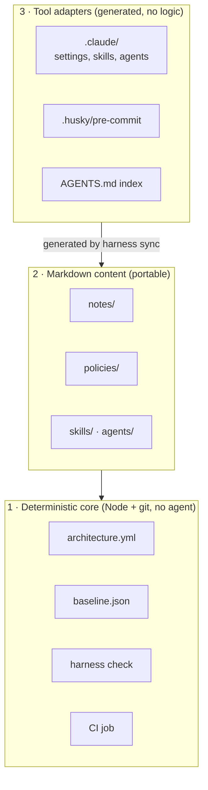

Each layer is optional: if one doesn't pay off for your team, delete it and the others keep working. Layer 3 is meant to be thrown away and regenerated when agent tools change their formats.

### What happens on a commit


The hook can be skipped with `--no-verify`, so **CI plus branch protection is the real guarantee**. The hook is there to fail fast.

### How `check` sees your code

The core never opens a `.js` file. A language adapter turns the repo into a list of edges, and the core applies the rules to that list.

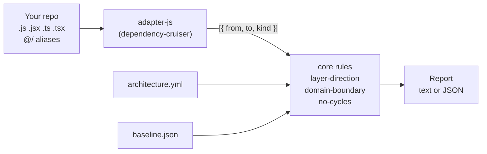

Rules:

| Rule | Fails when | Example |
| --- | --- | --- |
| `layer-direction` | A layer imports from a layer above it | `components/Button` imports from `features/billing` |
| `domain-boundary` | Code imports a domain's internals instead of its public API | `features/search` imports `features/billing/total.js` instead of `features/billing/index.js` |
| `no-cycles` | Modules import each other in a loop | `a → b → c → a` |
| `next-server-client` (optional, Next) | A `'use client'` component reaches a module that imports `server-only` or `next/headers` | `OrderList.tsx` (client) → `queries.ts` → `lib/db.ts` (`import 'server-only'`) |

Plus `integrity`, which warns when a PR changes `architecture.yml` or makes `baseline.json` grow (see below).

### Reading a report

Every finding says **which rule**, **why** and **how to fix it**, so an agent can fix it without asking:

```
✖ error layer-direction  src/components/PriceTag.js → src/features/billing/index.js
    Why: src/components/PriceTag.js (components) imports src/features/billing/index.js (features), but features is above components.
    Fix: Move what src/components/PriceTag.js needs from features down to components or a lower layer, or invert the dependency (pass it in as props or callbacks).

✖ error no-cycles  src/lib/a.js → src/lib/b.js
    Why: Import cycle: src/lib/a.js → src/lib/b.js → src/lib/c.js → src/lib/a.js.
    Fix: Break the cycle: move the code both sides need into a lower module, or invert one of the imports.

harness check: 2 new (2 errors, 0 warnings) · 0 in baseline · 0 fixed
Result: FAIL (new errors)
```

With `--json` the same data comes as JSON with a stable `schema` number, one object per finding: `rule`, `severity`, `status` (`new` / `baseline`), `from`, `to`, `message`, `fix`.

### Baseline: start green, only fail on new problems

A real repo already has violations. Fixing them all before adopting the harness isn't realistic, so they are frozen in `baseline.json` and `check` only fails on **new** ones.

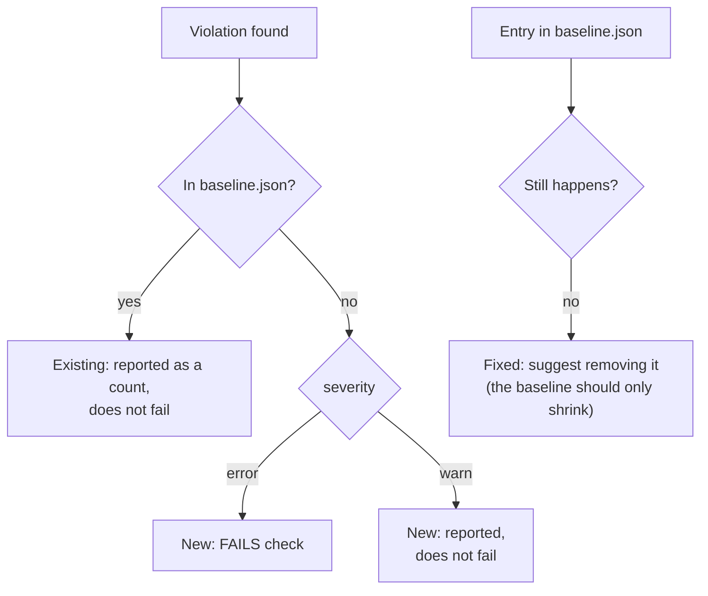

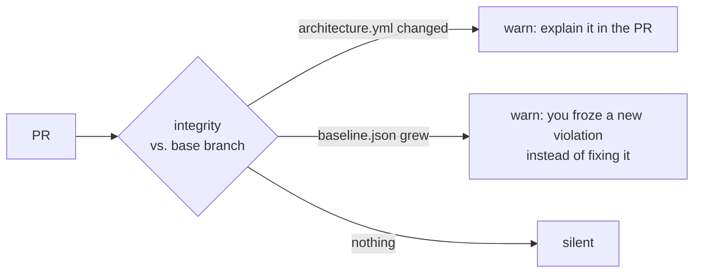

- **Baseline** = existing mess to fix someday. **`allow:`** = a decision, with a reason, that stays.
- `integrity` is `warn` by default; set it to `error` in `architecture.yml` to make those changes block.

Full reference of the file, rules, globs and defaults: [`docs/architecture-yml.md`](docs/architecture-yml.md).

### How the JS adapter reads your project

Aliases are the most likely source of silent bugs: if `@/features/x` doesn't resolve, that edge disappears and `check` can't see the violation. So the adapter reads them itself and **warns** about anything it can't resolve.

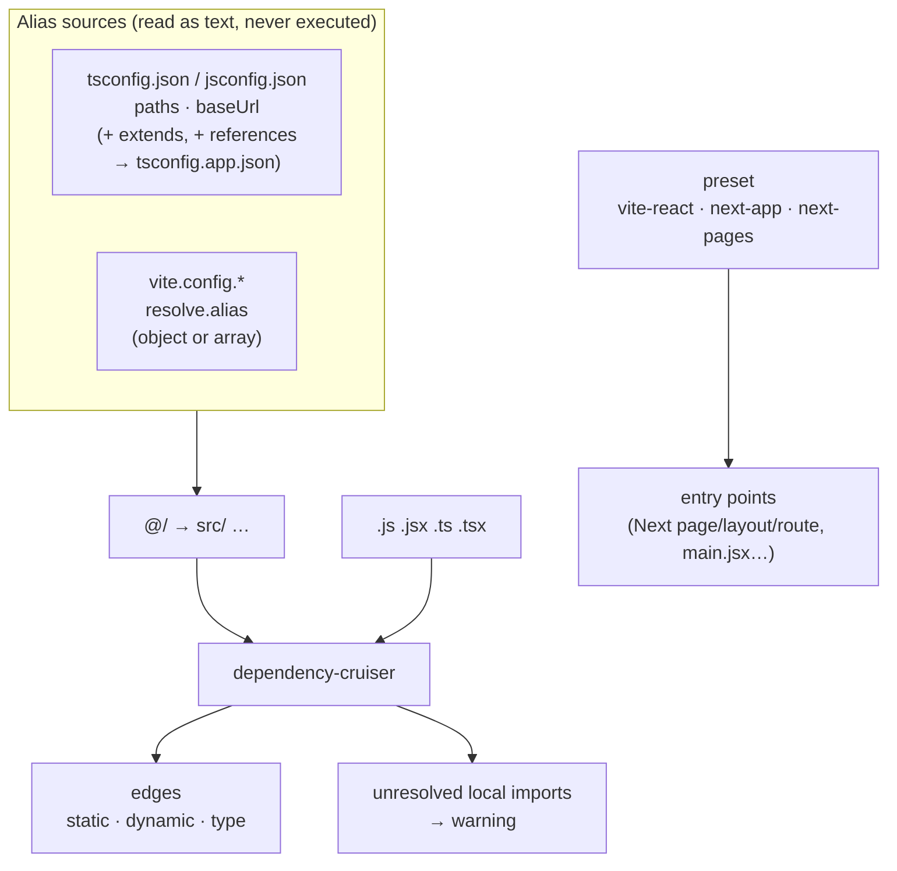

| Project | Works | Notes |
| --- | --- | --- |
| Vite + React, **plain JS/JSX** | ✅ | Nothing extra to install. Aliases from `jsconfig.json` or `vite.config.js` |
| Vite + React, TypeScript | ✅ | Needs `typescript` in the repo (it already is). Reads `tsconfig.app.json` through `references` |
| Next app router (JS or TS) | ✅ | `page`, `layout`, `route`… are entry points, not orphans |
| Next pages router (JS or TS) | ✅ | Every file under `pages/` is an entry point |

TypeScript repos use the `typescript` package they already have. If it's missing, the adapter says so clearly instead of skipping `.ts` files, so a green `check` always means the whole repo was checked.

### Packages and dependency direction

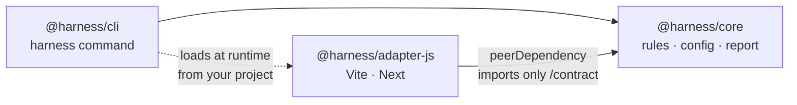

- `core` knows no framework and never imports `cli` or an adapter.
- Adapters only see `@harness/core/contract` (enforced by the `exports` field).
- Adapters are installed separately; if one is missing, the CLI tells you which one. It never installs anything.
- `@harness` is a **placeholder** scope; the final name is not decided.

## What lands in your repo

After installing, a consumer repo gets this. Files marked *local* stay out of git.

```
your-repo/
├── AGENTS.md                      # ≤ 30 lines: commands, golden rules, path → note index (generated)
├── CLAUDE.md                      # one line: @AGENTS.md
├── .harness/
│   ├── architecture.yml           # layers, domains, rules, exceptions  ← you decide this
│   ├── baseline.json              # frozen existing violations
│   ├── doctor.yml                 # doctor thresholds
│   ├── notes/<module>.md          # decisions and traps per module
│   ├── policies/                  # triage, progress, multiagent
│   ├── skills/  agents/           # sources for .claude/skills and .claude/agents
│   ├── review/checklist.md
│   ├── hooks/pre-commit.sh        # one line: harness check
│   ├── backlog/                   # local: audit findings
│   └── progress/                  # local: triage.log and per-branch notebook
├── .claude/                       # generated by harness sync, no logic of its own
├── .husky/pre-commit              # calls .harness/hooks/pre-commit.sh
└── .github/workflows/harness.yml  # CI job: harness check
```

Example `architecture.yml`:

```yaml
version: 1
adapter: js
preset: next-app

layers:                       # each layer may only import from the layers below it
  - { name: pages,      paths: ["src/app/**"] }
  - { name: features,   paths: ["src/features/**"] }
  - { name: components, paths: ["src/components/**"] }
  - { name: shared,     paths: ["src/hooks/**", "src/utils/**", "src/lib/**"] }

domains:
  billing: { paths: ["src/features/billing/**"], public_api: ["src/features/billing/index.js"] }

rules:
  - { id: layer-direction, severity: error }
  - { id: domain-boundary, severity: error }
  - { id: no-cycles,       severity: error }

allow:
  - { from: "src/features/search/**", to: "src/features/billing/**",
      reason: "Search shows prices; decided 2026-11" }
```

```
pages        ─┐
features      │  imports only go downwards
components    │
shared       ─┘
```

## Status of each piece

Everything below is built and tested. **Stable** pieces are enforced by tools. **Experimental** pieces guide the agent (notes, skills, notebook…): they work, and the team pilot will tell us which ones are worth keeping. Details: [`docs/STATUS.md`](docs/STATUS.md).

| Piece | Kind | Status |
| --- | --- | --- |
| `harness check`: layers, domains, cycles, baseline, integrity | stable | ✅ |
| `harness init`: draft plan, baseline and report | stable | ✅ |
| `adapter-js`: Vite + React and Next, JS or TS, `@/` aliases | stable | ✅ tested on [`examples/`](examples/) |
| `next-server-client` rule | stable (optional) | ✅ |
| Git hook (Husky, lefthook) + CI job | stable | ✅ blocks bad commits and PRs end to end |
| `harness install` | experimental | ✅ npm and pnpm |
| `harness sync`, `notes`, `scope` | experimental | ✅ notes reach Claude Code before it edits |
| Templates: `AGENTS.md`, policies, skills, agents | experimental | ✅ |
| `harness doctor` | experimental | ✅ |
| `harness audit`, `progress`, `review` | experimental | ✅ |

## Commands

### `harness init`

Drafts the plan from the code. The code says what exists, not what should exist, so the result is a draft for a person to review.

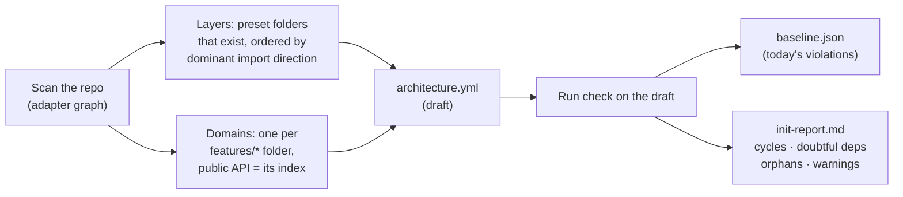

| Option | Effect |
| --- | --- |
| `--preset <name>` | `vite-react`, `next-app` or `next-pages` (default: detected) |
| `--dry-run` | Print the draft and the report, write nothing |
| `--force` | Overwrite existing files without asking (otherwise it asks, or refuses when there is no terminal) |

If the adapter is missing, it prints the install command for your package manager. It never installs anything.

### `harness check`

| Option | Effect |
| --- | --- |
| `--files <a,b>` | Only report violations involving these files (what the pre-commit hook runs) |
| `--json` | Machine-readable output for agents |
| `--base <ref>` | Base branch for `integrity` (default: `$GITHUB_BASE_REF`, `origin/HEAD`, `origin/main`, `main`) |
| `--update-baseline` | Freeze the current violations into `baseline.json` |
| `--verbose` | Also list violations already in the baseline |

Exit codes: **0** no new errors · **1** new errors · **2** could not run (config, adapter, options).

### `harness doctor`

Local, informational checks of **how the work is going**, not of the code. It reads files the agent writes, so it only sees what the agent wrote.

|  | `harness check` | `harness doctor` |
| --- | --- | --- |
| Guarantees | What enters git follows the rules | How the local workflow is going |
| Looks at | The code (import graph) | `triage.log`, the progress notebook, `AGENTS.md`, the local diff |
| Result | Blocks on new errors | Warnings only; exit 0 unless `--strict` |
| Runs in | Git hook and CI | Your machine, when the agent closes a task. **Never in CI** (skipped when `CI` is set) |
| Baseline / adapter | Yes / yes | No / no |

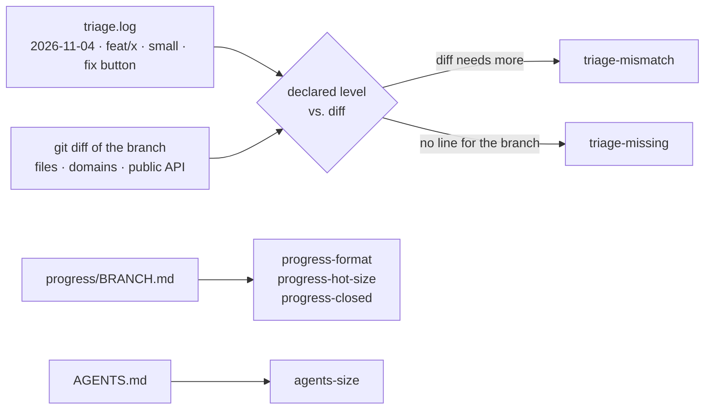

| Rule | Warns when |
| --- | --- |
| `triage-missing` | The branch has changes but no line in `triage.log` (or a line can't be read) |
| `triage-mismatch` | The diff exceeds the declared level: `small` = ≤ 3 files in 1 domain; `medium` = 1 domain; more domains, a public API or `architecture.yml` = `large` |
| `agents-size` | `AGENTS.md` is longer than 30 lines |
| `progress-hot-size` | The hot notebook is longer than 40 lines |
| `progress-format` | Missing header, invalid marker, more than one `[~]`, or a `[-]` without a reason |
| `progress-closed` | `status: closed` with done criteria not checked |

Thresholds are starting values in `.harness/doctor.yml`; tune them to your team:

```yaml
triage:
  small:  { max_files: 3, max_domains: 1 }
  medium: { max_domains: 1 }
agents_md: { max_lines: 30 }
progress:  { hot_max_lines: 40 }
```

Notebook format (`.harness/progress/<branch>.md`, local, outside git):

```markdown
# feat/discounts · status: open · updated: 2026-11-04
**Goal:** apply discounts in the cart.
**Done criteria:**
- [ ] discount applied to the total
- [ ] `harness check` without new violations
**Subtasks:**
- [x] model            (written, not tested)
- [~] UI               (in progress: only one)
- [-] coupons — out of scope, ticket 42
**Next step:** wire the UI.
```

### `harness sync`, `harness notes`, `harness scope`

`sync` generates the tool layer from the sources in `.harness/`. It only touches what it generated, recorded in `.harness/.generated.json`.

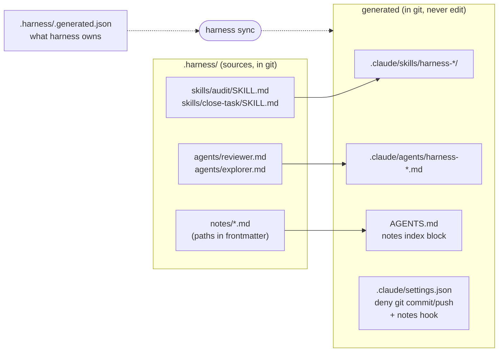

| Situation | What `sync` does |
| --- | --- |
| Third-party skill, agent or setting (e.g. another tool's hook) | Never touched |
| A file at a generated path that harness didn't create | Not touched; warning |
| A generated file edited by hand | Overwritten, with a message (edit the source instead); `--check` fails |
| A source deleted | Its generated files are removed (kept if edited by hand) |
| `AGENTS.md` / `CLAUDE.md` missing | Created from the templates; afterwards they belong to the repo (only the notes block is managed) |

`sync --check` writes nothing and fails if anything differs. Once `.generated.json` exists, `harness check` reports the same differences under `integrity`.

**How a module note reaches the agent:**


The `AGENTS.md` index line works with any agent (Codex, Cursor); the hook is the Claude Code fast path. Tested with Claude Code: the note arrives when the file is read, so the very first edit already follows it ([details](docs/VERIFIED.md#phase-6-findings)).

| Command | What it does |
| --- | --- |
| `harness notes <path…>` | Prints the notes that apply to each path |
| `harness notes --hook` | The same, as the Claude Code hook (JSON in/out, once per note and session) |
| `harness scope <path…>` | Domains, public APIs, notes to read and the minimum task level (`small` / `medium` / `large`) |

### `harness audit`, `harness progress`, `harness review`

Small commands so the agent edits local state **one line at a time** instead of rewriting files (cheaper, and the format can't break).

**`harness audit`**: the audit backlog, so "review the whole project" doesn't start from zero every few weeks.

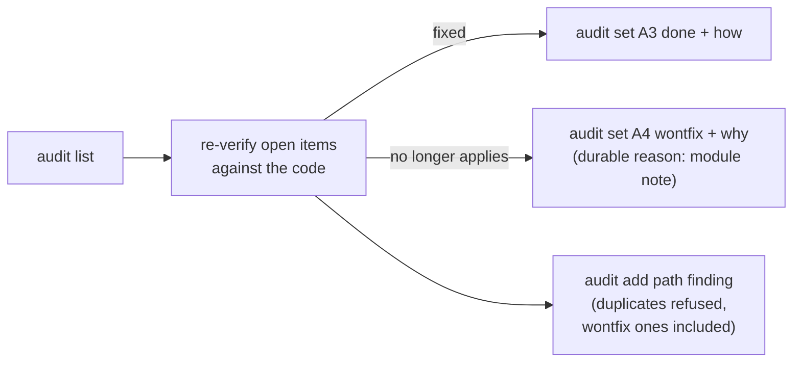

```markdown
- [open] A1 · 2026-11-04 · `src/lib/format.js` · Cache Intl.NumberFormat per locale.
- [open] [recheck] A2 · 2026-11-04 · `src/features/cart/` · Memoize the totals.
- [wontfix] A3 · 2026-11-04 · `src/api/` · Batch requests. — wontfix 2026-11-06: the API has no batch endpoint
```

| Command | Effect |
| --- | --- |
| `audit list [--status open\|done\|wontfix\|all] [--recheck]` | Show findings (default: open) |
| `audit add <path> <finding>` | New open finding |
| `audit set <id> <status> <reason>` | `done`/`wontfix` need a reason; clears `recheck` |
| `audit recheck <id…> \| open` | Flag findings to verify again |

**`harness progress`**: edits the branch notebook (`.harness/progress/<branch>.md`) and refuses anything that would break its format.

| Command | Effect |
| --- | --- |
| `progress new [--hot]` | Notebook from the template (mini; `--hot` adds the cold folder) |
| `progress show` | Numbered items |
| `progress add <text> [--criteria]` | `- [ ]` in Subtasks (or Done criteria) |
| `progress start <n>` | `[~]`; any other `[~]` goes back to `[ ]` |
| `progress done <n>` | `[x]` |
| `progress drop <n> <reason>` | `[-] … — reason` (kept, so it isn't proposed again) |
| `progress next <text>` | The "Next step" line |

**`harness review`**: prints a review prompt (instructions, changed files, checklist, notes of the touched paths, diff including uncommitted and untracked files) for any agent. It calls no API; `--executor` is the extension point for a future runner.

## Installation

Packages are not published yet: the team installs them from tarballs committed in each repo, so CI can install them too. Details, pnpm and alternatives: [`docs/team-install.md`](docs/team-install.md). To just try `init` and `check` first: [`docs/try-it.md`](docs/try-it.md).

```bash
# 1. In the harness repo: build the tarballs
pnpm install && pnpm pack:all

# 2. In your repo: commit them under vendor/harness/ and install them (npm shown; pnpm in team-install.md)
mkdir -p vendor/harness && cp /path/to/harness/.tarballs/*.tgz vendor/harness/
npm install -D ./vendor/harness/harness-core-0.0.0.tgz ./vendor/harness/harness-cli-0.0.0.tgz ./vendor/harness/harness-adapter-js-0.0.0.tgz

# 3. Wire it: .harness/ sources, .gitignore, pre-commit hook (Husky or lefthook), CI workflow, AGENTS.md, .claude/
npx harness install

# 4. Draft the architecture, review init-report.md, adjust architecture.yml, freeze today's violations
npx harness init
npx harness check --update-baseline

# 5. Check, commit everything, and protect the main branch in GitHub (PR + approval + "harness" job required)
npx harness check
```

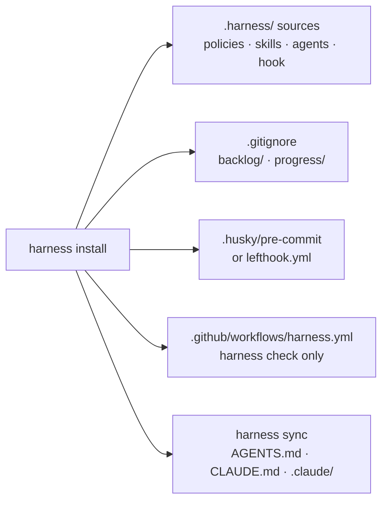

`harness install` is additive and idempotent: it never overwrites existing files (the workflow only with `--force`), never installs packages, and tells you what is missing (e.g. no Husky or lefthook: it explains how to add one). `--dry-run` shows what it would do.

Supported projects: Vite + React and Next (app and pages router), in **plain JS/JSX or TypeScript**. See [How the JS adapter reads your project](#how-the-js-adapter-reads-your-project).

## Roadmap

```mermaid
flowchart LR
    p0["0 · Verify<br/>assumptions"]:::done --> p1["1 · Skeleton"]:::done
    p1 --> p2["2 · Core check"]:::done --> p3["3 · adapter-js<br/>+ examples"]:::done --> p4["4 · CLI<br/>check + init"]:::done
    p4 --> gate{{"Pilot on<br/>team repos"}}
    gate --> p5["5 · doctor"]:::done --> p6["6 · Templates<br/>+ sync"]:::done --> p7["7 · audit,<br/>progress, review"]:::done --> p8["8 · install"]:::done --> p9["9 · Docs +<br/>self-check"]
    classDef done fill:#2e7d32,color:#fff,stroke:#1b5e20
```

Next: the pilot on the team's repos. Its feedback decides what stays, what gets simpler and what goes.

## Developing this repo

Requirements: Node ≥ 22, pnpm.

```bash
pnpm install
pnpm lint      # syntax, import boundaries, AGENTS.md rules, mermaid diagrams, package metadata
pnpm test      # every package + repo scripts (node:test)
pnpm pack:all  # tarballs in .tarballs/ to install in another repo
```

```
harness/
├── packages/
│   ├── core/            @harness/core        framework-agnostic: check, doctor, report, config, contract
│   ├── cli/             @harness/cli         the `harness` command
│   └── adapters/js/     @harness/adapter-js  Vite + React, Next; uses dependency-cruiser
├── templates/           files copied into consumer repos
├── examples/            vite-react (JS/JSX), next-app (TS): one test repo per preset
├── scripts/             lint.mjs, rename-scope.mjs, pack.mjs, verify/ (phase 0 experiments)
└── docs/                design, decisions, verification log, status
```

Rules for contributors (humans and agents) are in [`AGENTS.md`](AGENTS.md). In short: no commits by agents, everything in English, every new dependency justified in [`docs/DECISIONS.md`](docs/DECISIONS.md).

Renaming the npm scope: `pnpm rename-scope @new-scope --dry-run`, then without `--dry-run`, then `pnpm install`.

## Documentation

| Document | What's in it |
| --- | --- |
| [`docs/team-install.md`](docs/team-install.md) | Install in the team's repos without publishing; what goes in git; branch protection |
| [`docs/try-it.md`](docs/try-it.md) | Try `init` and `check` on a branch of your repo, without wiring anything |
| [`docs/DESIGN.md`](docs/DESIGN.md) | Full design (Spanish draft, source of truth) |
| [`docs/architecture-yml.md`](docs/architecture-yml.md) | `architecture.yml` and `baseline.json` reference: keys, rules, globs, defaults |
| [`docs/adapter-contract.md`](docs/adapter-contract.md) | What a language adapter must implement |
| [`docs/DECISIONS.md`](docs/DECISIONS.md) | What is decided, build defaults, dependencies, open questions |
| [`docs/VERIFIED.md`](docs/VERIFIED.md) | What we tested about Claude Code, pnpm and dependency-cruiser, with evidence |
| [`docs/STATUS.md`](docs/STATUS.md) | Stable vs. experimental, and what is built |

License: not decided yet.
