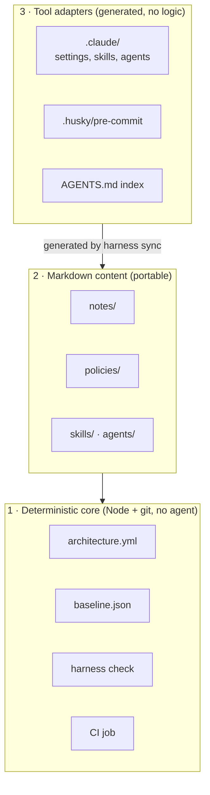
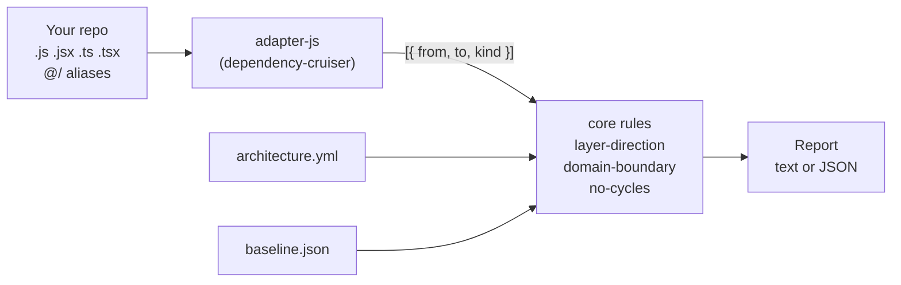
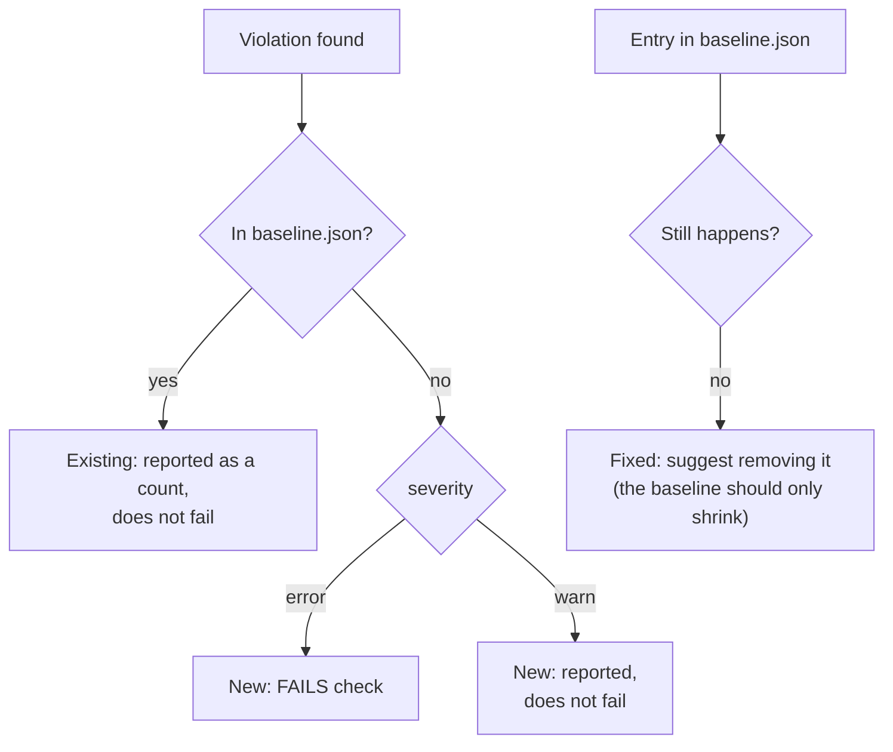
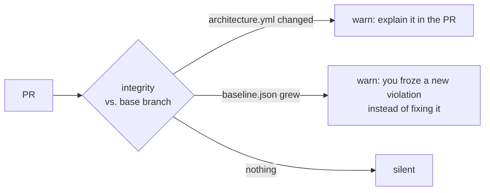
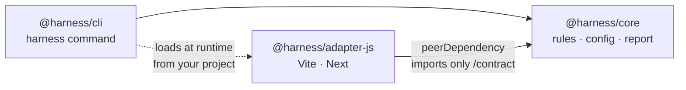

# harness

A harness for coding agents (Claude Code, Codex, Cursor…) working on frontend repos (Vite + React, Next).

It does two things:

1. **Enforces your architecture with a tool**, not with a prompt: `harness check` reads the import graph and fails when code breaks the layers, the domain boundaries or introduces cycles. It runs in a git hook and in CI, so it doesn't matter which agent or model wrote the code.
2. **Gives the agent short, portable markdown** (a 30-line `AGENTS.md`, per-module notes, policies, skills) so it spends fewer tokens and doesn't lose context between sessions.

> [!WARNING]
> **Work in progress — nothing is usable from the command line yet.** Phase **2 of 9** is done: the rules engine works and is tested, but the JS adapter (phase 3) and the `harness check` command (phase 4) don't exist yet. Nothing is measured: token savings and quality gains are hypotheses until the team pilot. See [Roadmap](#roadmap) and [`docs/STATUS.md`](docs/STATUS.md).

## Contents

- [The core idea: enforced vs. instructed](#the-core-idea-enforced-vs-instructed)
- [How it works](#how-it-works)
- [What lands in your repo](#what-lands-in-your-repo)
- [Status of each piece](#status-of-each-piece)
- [Installation (planned)](#installation-planned)
- [Roadmap](#roadmap)
- [Developing this repo](#developing-this-repo)
- [Documentation](#documentation)

## The core idea: enforced vs. instructed

Everything in the harness falls on one side of this line. Only the left side is a guarantee; the right side is text the agent may ignore.

| Enforced by a machine | Instruction the agent may ignore |
| --- | --- |
| `harness check` in the git hook and in CI | Announcing the task level (triage) |
| `baseline.json` (existing violations are frozen) | Progress notebook |
| Integrity of `architecture.yml`, `baseline.json` and generated files | Module notes, policies, skills, agents |
| Branch protection: PR with human approval + CI green | Audit backlog |
| Claude Code permissions denying `git commit` / `git push` ⚠️ partial: [known bypasses](docs/VERIFIED.md#p2-permissions-denying-git-commit--git-push--partial-pass) | Multi-agent rules |

`harness doctor` sits in the middle: it warns locally about what the agent wrote (triage log, notebook), but never blocks and never runs in CI.

## How it works

### Three layers

From most to least durable. Each layer only depends on the ones below it.



If a layer stops paying off during the pilot, it can be deleted without breaking the others. Layer 3 is meant to be thrown away and regenerated when agent tools change their formats.

### What happens on a commit


The hook can be skipped with `--no-verify`, so **CI plus branch protection is the real guarantee**. The hook is there to fail fast.

### How `check` sees your code

The core never opens a `.js` file. A language adapter turns the repo into a list of edges, and the core applies the rules to that list.



Rules:

| Rule | Fails when | Example |
| --- | --- | --- |
| `layer-direction` | A layer imports from a layer above it | `components/Button` imports from `features/billing` |
| `domain-boundary` | Code imports a domain's internals instead of its public API | `features/search` imports `features/billing/total.js` instead of `features/billing/index.js` |
| `no-cycles` | Modules import each other in a loop | `a → b → c → a` |

Plus `integrity`, which warns when a PR changes `architecture.yml` or makes `baseline.json` grow (see below).

### Reading a report

Every finding says **which rule**, **why** and **how to fix it**, so an agent can fix it without asking:

```
✖ error layer-direction  src/components/PriceTag.js → src/features/billing/index.js
    Why: src/components/PriceTag.js (components) imports src/features/billing/index.js (features), but features is above components.
    Fix: Move what src/components/PriceTag.js needs from features down to components or a lower layer, or invert the dependency (pass it in as props or callbacks).

✖ error no-cycles  src/lib/a.js → src/lib/b.js
    Why: Import cycle: src/lib/a.js → src/lib/b.js → src/lib/c.js → src/lib/a.js.
    Fix: Break the cycle: move the code both sides need into a lower module, or invert one of the imports.

harness check: 2 new (2 errors, 0 warnings) · 0 in baseline · 0 fixed
Result: FAIL (new errors)
```

With `--json` (phase 4) the same data comes as JSON with a stable `schema` number, one object per finding: `rule`, `severity`, `status` (`new` / `baseline`), `from`, `to`, `message`, `fix`.

### Baseline: start green, only fail on new problems

A real repo already has violations. Fixing them all before adopting the harness isn't realistic, so they are frozen in `baseline.json` and `check` only fails on **new** ones.





- **Baseline** = existing mess to fix someday. **`allow:`** = a decision, with a reason, that stays.
- `integrity` is `warn` by default; set it to `error` in `architecture.yml` to make those changes block.

Full reference of the file, rules, globs and defaults: [`docs/architecture-yml.md`](docs/architecture-yml.md).

### Packages and dependency direction



- `core` knows no framework and never imports `cli` or an adapter.
- Adapters only see `@harness/core/contract` (enforced by the `exports` field).
- Adapters are installed separately; if one is missing, the CLI tells you which one. It never installs anything.
- `@harness` is a **placeholder** scope; the final name is not decided.

## What lands in your repo

After installing, a consumer repo gets this. Files marked *local* stay out of git.

```
your-repo/
├── AGENTS.md                      # ≤ 30 lines: commands, golden rules, path → note index (generated)
├── CLAUDE.md                      # one line: @AGENTS.md
├── .harness/
│   ├── architecture.yml           # layers, domains, rules, exceptions  ← you decide this
│   ├── baseline.json              # frozen existing violations
│   ├── doctor.yml                 # doctor thresholds
│   ├── notes/<module>.md          # decisions and traps per module
│   ├── policies/                  # triage, progress, multiagent
│   ├── skills/  agents/           # sources for .claude/skills and .claude/agents
│   ├── review/checklist.md
│   ├── hooks/pre-commit.sh        # one line: harness check
│   ├── backlog/                   # local: audit findings
│   └── progress/                  # local: triage.log and per-branch notebook
├── .claude/                       # generated by harness sync, no logic of its own
├── .husky/pre-commit              # calls .harness/hooks/pre-commit.sh
└── .github/workflows/harness.yml  # CI job: harness check
```

Example `architecture.yml`:

```yaml
version: 1
adapter: js
preset: next-app

layers:                       # each layer may only import from the layers below it
  - { name: pages,      paths: ["src/app/**"] }
  - { name: features,   paths: ["src/features/**"] }
  - { name: components, paths: ["src/components/**"] }
  - { name: shared,     paths: ["src/hooks/**", "src/utils/**", "src/lib/**"] }

domains:
  billing: { paths: ["src/features/billing/**"], public_api: ["src/features/billing/index.js"] }

rules:
  - { id: layer-direction, severity: error }
  - { id: domain-boundary, severity: error }
  - { id: no-cycles,       severity: error }

allow:
  - { from: "src/features/search/**", to: "src/features/billing/**",
      reason: "Search shows prices; decided 2026-11" }
```

```
pages        ─┐
features      │  imports only go downwards
components    │
shared       ─┘
```

## Status of each piece

**Stable** = enforced by a tool and covered by tests. **Experimental** = depends on the agent reading or writing files, or on unverified tool behavior. Full table: [`docs/STATUS.md`](docs/STATUS.md).

| Piece | Planned status | Built |
| --- | --- | --- |
| `check` engine (rules, baseline, integrity, reports) | stable | ✅ in `@harness/core`, tested; no command yet |
| `architecture.yml` validation | stable | ✅ |
| `adapter-js` (Vite, Next, aliases) | stable | ❌ phase 3 |
| CLI `check` and `init` | stable | 🟡 skeleton (`--help`, `--version`) |
| Git hook + CI job | stable | ❌ phase 8 |
| `doctor` | experimental | ❌ |
| `sync`, `notes`, `scope` | experimental | ❌ |
| Templates (AGENTS.md, policies, skills, agents) | experimental | ❌ |
| `audit`, `progress`, `review` | experimental | ❌ |
| `install` | experimental | ❌ |

## Installation (planned)

> [!NOTE]
> Not available yet. Packages are not published; the team will install from tarballs (`pnpm pack`). This section is the target for phase 8.

```bash
# 1. Install the CLI and the adapter for your stack
pnpm add -D ./harness-cli-0.1.0.tgz ./harness-adapter-js-0.1.0.tgz

# 2. Scan the repo and draft the plan (never overwrites without asking)
pnpm harness init          # → .harness/architecture.yml, baseline.json, report

# 3. Review architecture.yml: the draft describes what exists, you decide what should exist

# 4. Wire the hook, CI and agent files
pnpm harness install       # pre-commit hook, CI job, .gitignore entries
pnpm harness sync          # AGENTS.md index, .claude/

# 5. Verify
pnpm harness check         # green: existing violations are in the baseline
```

Supported projects: Vite + React and Next (app and pages router), in **plain JS/JSX or TypeScript**. `@/` aliases are read from `jsconfig.json`/`tsconfig.json` and `vite.config`.

## Roadmap

```mermaid
flowchart LR
    p0["0 · Verify<br/>assumptions"]:::done --> p1["1 · Skeleton"]:::done
    p1 --> p2["2 · Core check"]:::done --> p3["3 · adapter-js<br/>+ examples"] --> p4["4 · CLI<br/>check + init"]
    p4 --> gate{{"Validation gate<br/>real repo"}}
    gate --> p5["5 · doctor"] --> p6["6 · Templates<br/>+ sync"] --> p7["7 · audit,<br/>progress, review"] --> p8["8 · install"] --> p9["9 · Docs +<br/>self-check"]
    classDef done fill:#2e7d32,color:#fff,stroke:#1b5e20
```



After phase 4, `init` and `check` are tried on a real team repo. Phases 5 onwards are only built if that goes well, and they ship as **experimental**.

## Developing this repo

Requirements: Node ≥ 22, pnpm.

```bash
pnpm install
pnpm lint      # syntax, import boundaries, AGENTS.md rules, package metadata
pnpm test      # every package + repo scripts (node:test)
```

```
harness/
├── packages/
│   ├── core/            @harness/core        framework-agnostic: check, doctor, report, config, contract
│   ├── cli/             @harness/cli         the `harness` command
│   └── adapters/js/     @harness/adapter-js  Vite + React, Next; uses dependency-cruiser
├── templates/           files copied into consumer repos
├── examples/            vite-react (JS/JSX), next-app (TS): one test repo per preset
├── scripts/             lint.mjs, rename-scope.mjs, verify/ (phase 0 experiments)
└── docs/                design, decisions, verification log, status
```

Rules for contributors (humans and agents) are in [`AGENTS.md`](AGENTS.md). In short: no commits by agents, everything in English, every new dependency justified in [`docs/DECISIONS.md`](docs/DECISIONS.md).

Renaming the npm scope: `pnpm rename-scope @new-scope --dry-run`, then without `--dry-run`, then `pnpm install`.

## Documentation

| Document | What's in it |
| --- | --- |
| [`docs/DESIGN.md`](docs/DESIGN.md) | Full design (Spanish draft, source of truth) |
| [`docs/architecture-yml.md`](docs/architecture-yml.md) | `architecture.yml` and `baseline.json` reference: keys, rules, globs, defaults |
| [`docs/adapter-contract.md`](docs/adapter-contract.md) | What a language adapter must implement |
| [`docs/DECISIONS.md`](docs/DECISIONS.md) | What is decided, build defaults, dependencies, open questions |
| [`docs/VERIFIED.md`](docs/VERIFIED.md) | What we tested about Claude Code, pnpm and dependency-cruiser, with evidence |
| [`docs/STATUS.md`](docs/STATUS.md) | Stable vs. experimental, and what is built |

License: not decided yet.
