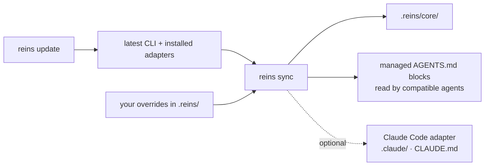
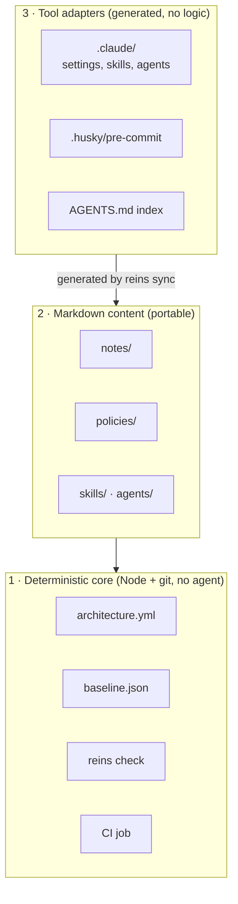
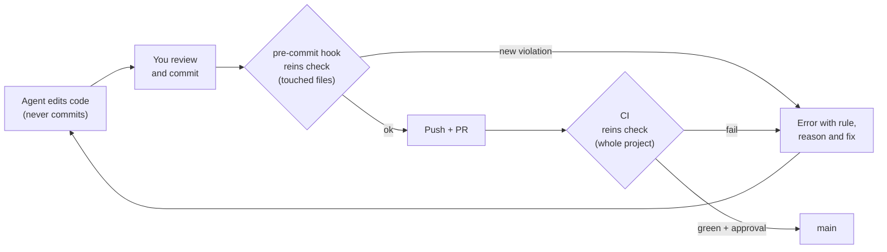

# reins

**reins is an engineering harness for AI coding agents.** It makes project knowledge persistent, architecture enforceable, and development workflows consistent across models, agents, and sessions.

Hold the reins of your coding agents: they respect your architecture and remember your project. reins is not a framework for building agents: it shapes how the agents you already use (Claude Code, Codex, Cursor or any other) work on your codebase.

Project site: **[fredarcito.github.io/reins](https://fredarcito.github.io/reins/)** · npm: [`@agentreins/cli`](https://www.npmjs.com/package/@agentreins/cli) · [`@agentreins/core`](https://www.npmjs.com/package/@agentreins/core) · [`@agentreins/adapter-js`](https://www.npmjs.com/package/@agentreins/adapter-js) · [`@agentreins/adapter-rails`](https://www.npmjs.com/package/@agentreins/adapter-rails)

Coding agents write code fast, but they forget, in two ways:

- **They forget your architecture.** A shared component imports from a feature, one feature reaches into another's internals, an import cycle appears, and nobody notices until the codebase is a tangle. Rules written in a prompt or in `CLAUDE.md` help, until the agent skips them.
- **They forget your project.** You come back to a module a week later and the agent reads all of its code again to work out what it does and why it was built that way. A long conversation gets compacted, and the decisions of the task go with it.

reins fixes both:

- **Your architecture becomes a check.** It runs on every commit and every pull request, whatever agent wrote the code. When something breaks a rule, the commit is blocked with the reason and the fix, so the agent corrects it before you even review.
- **Each module gets a short note.** What it does, how it works, the decisions taken and why, and its traps. The note reaches the agent before it explores: the first step of every task names the likely modules and hands over their notes, and the hook delivers them again when it opens a file. After a compaction the task's notebook comes back on its own. The agent starts from what the team already knows instead of rediscovering it.

**Made for** frontend teams on Vite + React or Next (plain JS/JSX or TypeScript) working with Claude Code, Codex, Cursor or any other agent.

**Your repo already uses reins?** Read the **[team guide](docs/team-guide.md)**: the plan, notes, how a task goes from start to PR, the reviewer, closing a task, the backlog, and what to ask your agent. This README is for adopting reins and understanding how it works.

## Without and with reins

| Without | With reins |
| --- | --- |
| A shared component imports from a feature. Someone spots it in review, or nobody does | The commit is blocked; the agent reads the fix and corrects it |
| A week later, the agent reads a whole module again to find out what it does and why | Its note (purpose, map, decisions with their why, traps) reaches the agent before it starts exploring the module |
| A long conversation gets compacted and the task's decisions are lost | The notebook and the notes of the files in play come back right after the compaction |
| Architecture rules live in a long prompt the agent skims | They live in `architecture.yml`, checked by a tool. The prompt stays at 45 lines |
| "Review the whole project" every few weeks, from scratch | Findings stay in a backlog; the next audit rechecks them |
| Adopting rules means fixing all the old debt first | Old debt is frozen in a baseline and can only shrink |

## Why use it

| | |
| --- | --- |
| 🔒 **Rules that can't be ignored** | Checked by a git hook and by CI, not by a prompt. Whatever agent or model wrote the code, it passes the same check. |
| 🧠 **Context that survives** | Module notes carry what a module does and why, from one session to the next. A per-branch notebook carries the task, and comes back by itself after a compaction. |
| 🟢 **Adopt it on the repo you already have** | `reins init` reads your code and drafts the architecture; `reins notes new` drafts a module's note from its imports. Today's violations are frozen in a baseline, so you start green and only *new* problems fail. |
| 🤖 **Errors an agent can fix alone** | Every finding says the rule, the reason and the fix, as text or JSON. |
| ✂️ **Less context, fewer tokens** | A 45-line `AGENTS.md` instead of a long prompt. A module's note arrives only when the agent works on that module. |
| 🔓 **No lock-in** | A Node CLI and plain markdown. No service, no API keys, no telemetry. Switch agents or models and nothing breaks; every piece is optional. |

## Quick start

In the root of your project (Node 22 or newer):

| Step | You do | What you get |
| --- | --- | --- |
| 1 · Install | `npm install -D @agentreins/cli @agentreins/adapter-js` | The CLI and the JavaScript/TypeScript adapter |
| 2 · Wire | `npx reins install` | Git hook, CI job, `AGENTS.md`, `.reins/` |
| 3 · Draft | `npx reins init` | Architecture plan, baseline, one note per domain |
| 4 · Review the plan | `/reins-arch` | Your agent proposes changes; you approve each one |
| 5 · Fill in the notes | `/reins-notes` | Each module explained for the next session |
| 6 · Freeze | `npx reins check --update-baseline`, then `npx reins check` | Today's violations frozen; only new ones fail |
| 7 · Commit | `git commit` | Only now: the pre-commit hook needs the plan |

- Steps 4 and 5 are done by your agent; don't skip them. The draft only describes what exists, and the notes start as templates.
- `/reins-arch` and `/reins-notes` are Claude Code commands. With other agents, ask: *"review .reins/init-report.md and propose changes to .reins/architecture.yml"*, then *"fill in the TODO lines of the notes in .reins/notes/"*.
- For a provider-neutral setup, use `npx reins install --skip-claude`.
- Ruby on Rails: install `@agentreins/adapter-rails` instead; with Inertia + React, install both adapters and `init` drafts one plan for the two.

Nothing of yours is overwritten: `install` and `init` only add files or ask first. With pnpm, `pnpm add -D`. More: [Installation](#installation) · [Updating](#updating) · a full tour with real output in [`docs/walkthrough.md`](docs/walkthrough.md).

## Day to day

After setup, people talk to their agent and the agent runs reins: it sizes each task, reads the notes, keeps a notebook, reviews and closes. What a task looks like, the reviewer, the backlog, and what to ask for common changes (add or remove a domain or a note, change the plan): **[docs/team-guide.md](docs/team-guide.md)**. Paste it as the description of your adoption PR, with your repo's layers and areas.

## Updating

```bash
npx reins update          # update the CLI and installed adapters, then sync the new core templates
npx reins doctor          # check the local workflow
npx reins check
npx reins notes stale     # notes that fell behind their code (no tokens); review the top ones with /reins-notes review
```

`reins update` uses your package manager (pnpm, yarn, bun or npm). Your own files, `baseline.json` and your notes are never touched; `architecture.yml` only gets format migrations, which show up in the diff (the changelog says when). Read the [changelog](CHANGELOG.md) entry of each version you skipped, then commit what changed (`.reins/`, `.claude/`, `AGENTS.md`).



→ What updates by itself and what doesn't, overrides and `--skip-claude`: [docs/updating.md](docs/updating.md)

## Skills for your agent

The workflow and skill sources are plain Markdown, independent of a model provider. In Claude Code, the optional adapter exposes commands such as `/reins-arch`; any other agent can follow `AGENTS.md`, read the same sources in `.reins/core/skills/` or `.reins/skills/`, and run the same `reins` CLI commands.

| Skill | What your agent does | When |
| --- | --- | --- |
| `/reins-done` | Closes a task: runs the checks once, updates the notebook and the notes of the modules it touched, says what was and wasn't verified | When a task is done |
| `/reins-backlog` | Shows what is pending in the backlog, proposes what to do next (checked against the code), adds, closes or drops items | "What's pending?", "what should we do next?" |
| `/reins-notes` | Reads each module and fills in its note. Writes only decisions it can back up; the rest become `- ? question` lines for you | After `init` or `notes new` |
| `/reins-notes review` | Checks notes against the code and fixes what is no longer true | Every few weeks, or when doctor flags notes |
| `/reins-arch` | Reviews `.reins/architecture.yml` against the code and proposes changes with evidence. **Applies nothing until you approve each one** | After `init`, and every few months |
| `/reins-audit` | Looks for new improvements in the code and adds only new findings to the backlog | "Review the whole project" |
| `/reins-agent` | Creates a new subagent in `.reins/agents/` (read-only by default) and generates it for Claude Code | When you want a new agent: a tester, an a11y checker… |

## Contents

- [Without and with reins](#without-and-with-reins) · [Why use it](#why-use-it) · [Quick start](#quick-start)
- [Day to day](#day-to-day) · [Updating](#updating) · [Skills for your agent](#skills-for-your-agent)
- [The core idea: enforced vs. instructed](#the-core-idea-enforced-vs-instructed)
- [How it works](#how-it-works) · [Context between sessions](#context-between-sessions)
- [Commands](#commands) · [Installation](#installation)
- [Status of each piece](#status-of-each-piece) · [Roadmap](#roadmap) · [Developing this repo](#developing-this-repo) · [Documentation](#documentation)

## The core idea: enforced vs. instructed

Everything in reins falls on one side of this line. The left side is guaranteed by tools; the right side guides the agent with short markdown, and works as long as the agent follows it.

| Enforced by a machine | Guidance for the agent |
| --- | --- |
| `reins check` in the git hook and in CI | Sizing each task: the agent runs `reins triage`, reins measures the level |
| `baseline.json` (existing violations are frozen) | Progress notebook |
| Integrity of `architecture.yml`, `baseline.json` and generated files | Module notes, policies, skills, agents |
| Branch protection: PR with human approval + CI green | Audit backlog |
| Claude Code permissions denying `git commit` / `git push` (a first line of defense: [details](docs/VERIFIED.md#p2-permissions-denying-git-commit--git-push--partial-pass)) | Multi-agent rules |

`reins doctor` sits in the middle: it warns locally about what the agent wrote (triage log, notebook), but never blocks and never runs in CI.

## How it works

Three layers, from most to least durable. Each layer only depends on the ones below it, and each is optional: if one doesn't pay off for your team, delete it and the others keep working.



What happens on a commit:



The hook can be skipped with `--no-verify`, so **CI plus branch protection is the real guarantee**. The hook is there to fail fast. Four rules run on every check: `layer-direction`, `domain-boundary`, `no-cycles` and, for Next, `next-server-client`. Today's violations are frozen in a baseline, so you start green and only new ones fail. Every finding says the rule, the reason and the fix.

**Compared with where your branch started.** Locally, reins compares a branch with the commit it was created from, so a task cut from `staging` or from a feature branch shows only its own files, with nothing to configure. In CI it uses the pull request's target. A team whose tasks start from `staging` can also write `base: origin/staging` in `architecture.yml` once, for everyone: [which base reins compares with](docs/commands.md#which-base-reins-compares-with).

On every pull request, CI also posts **one comment with the architecture map**: the new dependencies between domains, the folders no rule covers and who imports the changed code, so one new import isn't a single line among hundreds. It is plain templates filled with data (no AI) and experimental.

→ The rules with examples, a sample report, the baseline, the PR map, how the JS adapter reads aliases, the packages: [docs/how-it-works.md](docs/how-it-works.md) · `architecture.yml` reference: [docs/architecture-yml.md](docs/architecture-yml.md)

## Context between sessions

Two kinds of memory, both plain markdown in `.reins/`:

| | Module note | Task notebook |
| --- | --- | --- |
| File | `.reins/notes/<module>.md`, **in git** | `.reins/progress/<branch>/<task>/notebook.md`, local |
| Lives | As long as the module | As long as the task |
| Holds | Purpose, map, how it works, decisions with their why, traps | Goal, done criteria, subtasks, next step |
| Written by | `reins init` drafts one per domain; the agent fills in and updates it when closing a task | The agent, one line at a time with `reins progress` |

```mermaid
flowchart LR
    subgraph mem["Memory in .reins/"]
        direction TB
        note["notes/cart.md"]
        nb["progress/feat-x/css/notebook.md"]
    end
    subgraph when["When it reaches the agent"]
        direction TB
        triage["Starts a task<br/>reins triage"]
        open["Opens or searches the module<br/>PreToolUse hook"]
        start["Session start, /clear,<br/>compaction<br/>SessionStart hook"]
        any["Any agent<br/>AGENTS.md index ·<br/>reins resume"]
    end
    note --> triage
    note --> open
    note --> start
    nb --> start
    note --> any
    nb --> any
    triage --> agent["Agent"]
    open --> agent
    start --> agent
    any --> agent
```



Coming back to a module a week later, the agent opens `src/features/cart/cartStore.js` and, before it edits anything, receives:

```markdown
## Purpose
Cart state and totals for the checkout.

## Map
- Public API: `src/features/cart/index.js`
- `cartStore.js`: the single source of truth; components only read from it.

## Decisions
- 2026-10-28: totals are integer cents. Why: float rounding broke the invoices.

## Traps
- `clear()` keeps the coupon on purpose: the coupon belongs to the session, not to the cart.
```

After a compaction the task's notebook and the notes of the files in play come back by themselves. Several tasks can live on one branch, one notebook each. `reins doctor` warns when a note falls behind its code.

→ What goes in each section, parallel sessions, notes for big modules, keeping notes current: [docs/context-between-sessions.md](docs/context-between-sessions.md)

## Commands

Your agent runs these for you. You mostly talk to it; this is what it uses. `npx reins --help` lists every command and flag.

| Command | What it does |
| --- | --- |
| `reins install` | Wires the git hook, CI job, `AGENTS.md` and `.reins/` (additive, never overwrites) |
| `reins init` | Drafts the architecture plan, the baseline and a note per domain from your code (`--dry-run` to preview) |
| `reins check` | Checks the rules; exit 1 on new errors. `--files`, `--json`, `--update-baseline`, `--coverage` |
| `reins doctor` | Local warnings about how the work is going (triage, notebook, notes). Never blocks, never runs in CI |
| `reins sync` | Refreshes `.reins/core`, the `AGENTS.md` blocks and the optional Claude Code files |
| `reins update` | Updates the CLI and adapters, then runs `sync` |
| `reins notes <path…>` | The notes that apply to a path. `notes new <folder>` drafts one; `notes stale` ranks the ones behind their code |
| `reins scope <path…>` · `reins impact <file>` | Path → domains and minimum task level · file → the domains that import it |
| `reins resume` | The session's task notebook and notes: what an agent needs to pick a task up |
| `reins triage "<why>"` | Before exploring: the likely areas of the task and their module notes (word matching; nothing recorded) |
| `reins triage "<why>" --files <paths>` | Measures the task level from the files the agent expects to touch, and records it |
| `reins progress` · `reins audit` | The task notebook and the audit backlog, edited one line at a time |
| `reins review` | A review prompt with the diff, checklist and notes (`--map` for the PR architecture map) |

→ Options, output formats, doctor rules and notebook format: [docs/commands.md](docs/commands.md)

## Installation

The packages are on npm under `@agentreins`. Without a registry (offline, or a version not published yet), install from tarballs: [`docs/team-install.md`](docs/team-install.md). To just try `init` and `check` on a branch first: [`docs/try-it.md`](docs/try-it.md).

```bash
# 1. Install the CLI and the JavaScript/TypeScript adapter (pnpm: pnpm add -D …)
npm install -D @agentreins/cli @agentreins/adapter-js
#    Ruby on Rails: @agentreins/adapter-rails (with Inertia + React, install both adapters)

# 2. Wire it: .reins/ sources, .gitignore, pre-commit hook (Husky or lefthook), CI workflow, AGENTS.md
npx reins install --skip-claude    # omit optional Claude Code files for a provider-neutral setup

# 3. Draft the architecture plan, the baseline and the module notes
npx reins init

# 4. Review the plan with your agent: /reins-arch in Claude Code (it drafts the notes of the domains it adds)
# 5. Fill in the notes with your agent: /reins-notes in Claude Code

# 6. Freeze today's violations, check, commit everything (not before: the hook needs the plan),
#    and protect the main branch in GitHub (PR + approval + "reins" job required)
npx reins check --update-baseline
npx reins check
```

`reins install` is additive and idempotent: it never overwrites existing files, never installs packages, and tells you what is missing. `--dry-run` shows what it would do. Supported projects: Vite + React and Next (app and pages router), in **plain JS/JSX or TypeScript**, and Ruby on Rails, with or without an Inertia frontend.

The repo you get, the example `architecture.yml` and the layers: [docs/how-it-works.md](docs/how-it-works.md#what-lands-in-your-repo).

## Status of each piece

Everything below is built and tested. **Stable** pieces are enforced by tools. **Experimental** pieces guide the agent (notes, skills, notebook…): they work, and the team pilot will tell us which ones are worth keeping. Details: [`docs/STATUS.md`](docs/STATUS.md).

| Piece | Kind | Status |
| --- | --- | --- |
| `reins check`: layers, domains, cycles, baseline, integrity | stable | ✅ |
| `reins init`: draft plan, baseline and report | stable | ✅ |
| `adapter-js`: Vite + React and Next, JS or TS, `@/` aliases | stable | ✅ tested on [`examples/`](examples/) |
| `next-server-client` rule | stable (optional) | ✅ |
| `adapter-rails`: Ruby on Rails, with [Inertia](https://inertia-rails.dev) pages | experimental | ✅ reads Ruby without needing Ruby installed; tried on a Rails app of 4,400 files in 1.5 s |
| Several languages in one repo (`adapters: [rails, js]`) | experimental | ✅ one plan and one baseline for every language; `init` drafts it for all of them; a Rails controller is linked to the React page it renders |
| Git hook (Husky, lefthook) + CI job | stable | ✅ blocks bad commits and PRs end to end |
| `reins install`, `reins update` | experimental | ✅ install tested with npm and pnpm; update package-manager selection tested in dry-run; shared `AGENTS.md` workflow does not require Claude Code |
| `reins sync`, `notes`, `scope` | experimental | ✅ notes reach Claude Code before it edits |
| `reins impact` | experimental | ✅ the domains that consume a file, before the refactor |
| `reins notes new`, `resume` + `SessionStart` hook | experimental | ✅ notebook and notes come back after a compaction |
| Skills `arch`, `notes`, `agent` | experimental | ✅ tested with Claude Code |
| Templates: `AGENTS.md`, policies, skills, agents | experimental | ✅ |
| `reins doctor` | experimental | ✅ |
| `reins audit`, `progress`, `review` | experimental | ✅ |

## Roadmap

```mermaid
flowchart LR
    p0["0 · Verify<br/>assumptions"]:::done --> p1["1 · Skeleton"]:::done
    p1 --> p2["2 · Core check"]:::done --> p3["3 · adapter-js<br/>+ examples"]:::done --> p4["4 · CLI<br/>check + init"]:::done
    p4 --> gate{{"Pilot on<br/>team repos"}}
    gate --> p5["5 · doctor"]:::done --> p6["6 · Templates<br/>+ sync"]:::done --> p7["7 · audit,<br/>progress, review"]:::done --> p8["8 · install"]:::done --> p9["9 · Docs +<br/>self-check"]:::done
    classDef done fill:#2e7d32,color:#fff,stroke:#1b5e20
```



Next: the pilot on the team's repos. Its feedback decides what stays, what gets simpler and what goes.

## Developing this repo

Requirements: Node ≥ 22, pnpm.

```bash
pnpm install
pnpm lint       # syntax, import boundaries, AGENTS.md rules, mermaid diagrams, package metadata
pnpm test       # every package + repo scripts (node:test)
pnpm self-check # this repo's own architecture, checked by its own reins check
pnpm pack:all   # tarballs in .tarballs/ to install in another repo
```

Packages: `packages/core` (framework-agnostic checks), `packages/cli` (the `reins` command), `packages/adapters/js` (Vite + React, Next). Templates copied into consumer repos live in `templates/`, test repos in `examples/`, the landing page in `site/`. Dependency direction: `cli` → `adapters` → `core`. How to contribute: [`CONTRIBUTING.md`](CONTRIBUTING.md). Rules for agents working here: [`AGENTS.md`](AGENTS.md).

## Documentation

| Document | What's in it |
| --- | --- |
| [Project site](https://fredarcito.github.io/reins/) | The landing page, served by GitHub Pages; source in [`site/`](site/) |
| [`docs/team-guide.md`](docs/team-guide.md) | For the whole team: the plan, notes, a task from start to PR, reviewer, backlog, what to ask your agent |
| [`docs/walkthrough.md`](docs/walkthrough.md) | Full tour on an example app, with real output: install, init, a blocked commit, notes, doctor |
| [`docs/how-it-works.md`](docs/how-it-works.md) | Rules, reports, baseline, the PR architecture map, the JS adapter, packages, what lands in your repo |
| [`docs/context-between-sessions.md`](docs/context-between-sessions.md) | Module notes and task notebooks in detail |
| [`docs/commands.md`](docs/commands.md) | Every command: options, output, doctor rules, notebook format |
| [`docs/updating.md`](docs/updating.md) | What updates by itself and what doesn't |
| [`docs/architecture-yml.md`](docs/architecture-yml.md) | `architecture.yml` and `baseline.json` reference: keys, rules, globs, defaults |
| [`docs/try-it.md`](docs/try-it.md) | Try `init` and `check` on a branch of your repo, without wiring anything |
| [`docs/team-install.md`](docs/team-install.md) | Install in the team's repos without publishing; what goes in git; branch protection |
| [`docs/team-adoption.md`](docs/team-adoption.md) | The pilot: metrics, how to measure them, keep / simplify / drop; template [`docs/PILOT.md`](docs/PILOT.md) |
| [`docs/publishing.md`](docs/publishing.md) | How to publish the three packages to npm |
| [`docs/adapter-contract.md`](docs/adapter-contract.md) | What a language adapter must implement |
| [`docs/DESIGN.md`](docs/DESIGN.md) | Full design (Spanish draft, source of truth) |
| [`docs/DECISIONS.md`](docs/DECISIONS.md) | What is decided, build defaults, dependencies, open questions |
| [`docs/VERIFIED.md`](docs/VERIFIED.md) | What we tested about Claude Code, pnpm and dependency-cruiser, with evidence |
| [`docs/STATUS.md`](docs/STATUS.md) | Stable vs. experimental, and what is built |
| [`CHANGELOG.md`](CHANGELOG.md) · [`CONTRIBUTING.md`](CONTRIBUTING.md) | Versions; how to contribute |

License: [MIT](LICENSE).
