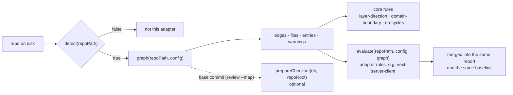

# Adapter contract (version 1)

A language adapter turns a repo into a list of edges "file A depends on file B". The core never opens a source file, so everything specific to a language or framework (imports, `@/` aliases, Next special files, `'use client'`) lives in the adapter.



## Shape

```js
import { CONTRACT_VERSION } from '@agentreins/core/contract';

export default {
  name: 'js',                    // matches an entry of `adapters:` in architecture.yml
  contract: CONTRACT_VERSION,    // 1
  detect(repoPath) {},           // boolean (or Promise): does this adapter apply?
  graph(repoPath, config) {},    // GraphResult (or Promise)
  rules: ['next-server-client'], // optional: extra rule ids it implements
  evaluate(repoPath, config, graph) {}, // required if `rules` is not empty
  presets: ['vite-react', 'next-app', 'next-pages'], // optional, used by `reins init`
  suggestPreset(repoPath) {},    // optional: best preset name, or null
  loadPreset(name) {},           // optional: { description, layers, domains_from, route_domains_from?, entries, default_rules? }
  prepareCheckout(dir, repoRoot) {}, // optional: make a checkout of another commit analyzable → { warnings }
};
```

Without `presets`/`loadPreset`, `reins init` can't draft a plan and asks the user to write `architecture.yml` by hand; `check` works the same.

In a repo with several adapters (`adapters: [js, rust]`), every adapter gets the repo root and must return only the files of its language. Rule ids must not collide with another adapter's, and `config.preset` is left out unless the preset is in the adapter's `presets`.

`validateAdapter()` from `@agentreins/core/contract` checks this shape; the CLI refuses an adapter that fails it.

## `graph()` result

Either an array of edges, or an object:

| Field | Required | What |
| --- | --- | --- |
| `edges` | yes | `[{ from, to, kind }]`, see below |
| `files` | no | Every source file scanned. Lets `reins init` find orphans |
| `entries` | no | Files that are entry points by convention (Next `page`/`layout`/`route`, `src/main.jsx`…). Never orphans |
| `warnings` | no | Problems the user must see, e.g. imports that could not be resolved |
| `barrels` | no | Files that only re-export other modules (e.g. `components/index.js`) |
| `uses` | no | `[{ from, to }]`: what an importer really uses through barrels (`to` is the file behind the barrel). `reins init` reads it to see which domain uses a folder, and `reins impact` to count importers behind a barrel as consumers of the real file; the rules keep checking `edges` |

`normalizeGraph()` turns either form into the object form.

### Edges

| Field | Rule |
| --- | --- |
| `from` | File that imports. Relative to the repo root, `/` separators, no leading `./`, no `..` |
| `to` | Imported file, same format. Only files inside the repo: leave out `node_modules` and builtins |
| `kind` | Non-empty string. Recommended: `static`, `dynamic`, `type` |

`validateEdges()` checks this; the CLI runs it on every adapter's output.

**Never drop edges silently.** If the adapter can't read part of the repo (an unresolved alias, a missing parser), it must say so in `warnings` or throw. A missing edge means a violation `check` can't see.

## Adapter rules: `evaluate()`

Rules that need more than edges (file contents, directives) live in the adapter. `evaluate(repoPath, config, graph)` receives the parsed `architecture.yml` and the normalized graph, and returns findings with the same fields as core violations:

```js
{ rule, severity, key, from, to?, files?, message, fix }
```

- The rule ids must be listed in `rules`, so `architecture.yml` validation accepts them.
- `severity` comes from the rule's entry in `architecture.yml`; a rule that isn't listed is off.
- `key` must be stable across runs: it is what the baseline stores.

## Checkout of another commit: `prepareCheckout()`

`reins review --map` compares the branch with its merge base, so it needs the graph of **another commit**. The CLI checks that commit out in a `git worktree` (`.reins/tmp/pr-map-base-<pid>/`, removed afterwards) and calls the **already loaded** adapter's `graph()` on it (the adapter is never resolved again inside the checkout). A fresh checkout has no installed dependencies, and for a language where resolution depends on them the base graph would differ from the head's for reasons that have nothing to do with the PR.

`prepareCheckout(checkoutDir, repoRoot)` is optional. When the adapter has it, the CLI calls it after creating the worktree and before `graph()`. It makes the checkout analyzable **without installing anything**, and returns `{ warnings: string[] }` (what could not be prepared; the CLI prints them). It must not touch `repoRoot`.

The JS adapter mirrors every `node_modules` entry by entry: workspace links are recreated so they resolve to the checkout's own packages (the base version), and everything else points at the main checkout's install. With Yarn Plug'n'Play it only warns. Details and why not whole folders: [proposals/pr-map.md](proposals/pr-map.md), section 5. An adapter whose language needs nothing (no installed dependencies to resolve) omits it.

## What adapters may import from the core

Only `@agentreins/core/contract` (the core's `exports` field blocks everything else):

| Export | Use |
| --- | --- |
| `CONTRACT_VERSION` | The `contract` field |
| `matchesAny(file, globs)` | Same glob semantics as `architecture.yml` |
| `validateEdges`, `normalizeGraph`, `validateAdapter` | Self-checks in the adapter's tests |
| JSDoc types `Edge`, `GraphResult`, `Adapter`, `AdapterViolation` | Typing |

## Packaging

| Field in the adapter's `package.json` | Value |
| --- | --- |
| `name` | `@agentreins/adapter-<name>` (official) or `reins-adapter-<name>` (third party) |
| `keywords` | include `reins-adapter` |
| `peerDependencies` | `"@agentreins/core": "^<version>"`, never a regular dependency |
| `reins.contract` | the contract version it implements, e.g. `1` |
| `exports` | expose `./package.json`, so the CLI can read `reins.contract` |

Heavy dependencies (dependency-cruiser…) belong to the adapter, never to the core or the CLI.

## Versioning

The CLI refuses an adapter whose `contract` differs from the core's `CONTRACT_VERSION`, and says which version to install. Package managers only **warn** on an incompatible peer dependency ([VERIFIED.md, P7](VERIFIED.md#p7-peerdependencies-with-pnpm--pass)), so this check is the real one.

Version 1 grew without breaking: in phase 3 `graph()` may return an object instead of an array, and `rules` + `evaluate` were added; in phase 4, `presets`, `suggestPreset` and `loadPreset`; for the PR map, `prepareCheckout`. All optional. The contract will probably change for real when a second adapter (Ruby/Packwerk) arrives; that would be contract 2.

## Reference implementation: `@agentreins/adapter-js`

| Piece | What it does |
| --- | --- |
| `detect` | `vite.config.*` → Vite; `next.config.*` → Next (app, pages or both routers) |
| aliases | Reads `jsconfig.json`/`tsconfig.json` `paths` and `baseUrl` (following `extends` and `references`) and `resolve.alias` in `vite.config.*`, statically. No TypeScript needed for JS projects |
| `graph` | dependency-cruiser with those aliases. Edge kinds: `type` (type-only imports), `dynamic` (`import()`), `static` |
| presets | `vite-react`, `next-app`, `next-pages`: starting layers for `init` and entry-point globs |
| `prepareCheckout` | Mirrors `node_modules` into a worktree of another commit (pnpm workspace links stay relative); warns with Yarn PnP |
| `next-server-client` | Optional rule: a `'use client'` component must not reach a module that imports `server-only` or `next/headers` |
