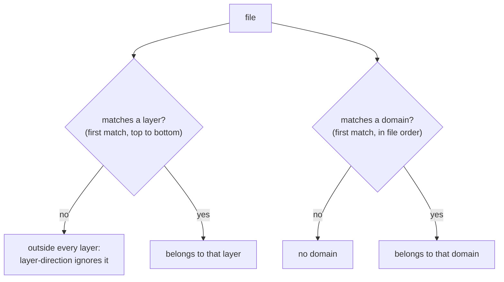

# `architecture.yml` reference

The plan of your architecture. `reins check` enforces whatever this file says, even a bad plan: **a person decides it**, `reins init` only drafts it from what exists.

Location in a consumer repo: `.reins/architecture.yml`.

## Full example

```yaml
version: 1            # required, always 1 for now
adapters: [js]        # required: the language adapters that compute the graph (Rails + React: [js, rails])
preset: next-app      # optional: vite-react | next-app | next-pages | inertia-react | rails (adapter presets)
ignore: ["src/generated/**"]   # optional: files left out of the analysis

layers:               # ordered from TOP to BOTTOM
  - { name: pages,      paths: ["src/app/**"] }
  - { name: features,   paths: ["src/features/**"] }
  - { name: components, paths: ["src/components/**"] }
  - { name: shared,     paths: ["src/hooks/**", "src/utils/**", "src/lib/**"] }

domains:
  billing: { paths: ["src/features/billing/**"], public_api: ["src/features/billing/index.js"] }
  search:  { paths: ["src/features/search/**"],  public_api: ["src/features/search/index.{js,ts}"] }

rules:
  - { id: layer-direction, severity: error, ignore_kinds: [type] }
  - { id: domain-boundary, severity: error }
  - { id: no-cycles,       severity: error }
  - { id: integrity,       severity: warn }

allow:
  - { from: "src/features/search/**", to: "src/features/billing/**",
      reason: "Search shows prices; decided 2026-11" }
```

## Keys

| Key | Required | What it is |
| --- | --- | --- |
| `version` | yes | Format version. Must be `1` |
| `adapters` | yes | List of adapter names, e.g. `[js]`, or `[js, rust]` for a repo with several languages (see [Several languages](#several-languages-in-one-repo)). For each name the CLI looks for `@agentreins/adapter-<name>`, then `reins-adapter-<name>`. Plans from reins 0.11.0 or older said `adapter: js`; `reins update` rewrites it |
| `preset` | no | Preset of the adapter (with several adapters, only the one that has this preset receives it; a preset no adapter has is an error) |
| `ignore` | no | Globs of files left out of the analysis entirely: generated code, fixtures, storybook. Imports from or to them are not checked and don't produce warnings |
| `layers` | no | List of `{ name, paths }`, top layer first |
| `domains` | no | Map of name → `{ paths, public_api }` |
| `rules` | no | List of `{ id, severity, message?, fix?, ignore_kinds?, options? }` |
| `allow` | no | List of `{ from, to, reason, rule? }` |

Unknown keys are errors, so a typo (`adaptor:`) never passes silently. Every problem is reported at once, with the exact field (`layers[1].paths: …`).

## Several languages in one repo

A repo with a JavaScript frontend and a Rust backend (Tauri, say) lists both adapters in one plan. Adding a language later is adding its name to the list (and installing its adapter):

```yaml
version: 1
adapters: [js, rust]
layers:
  - { name: ui,       paths: ["src/components/**"] }
  - { name: utils,    paths: ["src/utils/**"] }
  - { name: commands, paths: ["src-tauri/src/commands/**"] }
  - { name: audio,    paths: ["src-tauri/src/audio/**"] }
```

- Each adapter receives the repo root and finds its own files. `check`, `impact`, `scope`, `notes` and the PR map work on the union of their graphs, with one baseline.
- Layers, domains and `allow` are paths, so they apply to every language the same way.
- Each adapter runs its own rules on its own graph. Two adapters may not declare the same rule id.
- Languages usually talk through strings (a Tauri `invoke("name")`, an HTTP route), not imports, so no edge crosses from one language to the other: a rule between a JS layer and a Rust layer never fires. The exception is Inertia, below.
- `reins init` drafts one plan for every adapter the repo needs: each adapter brings its preset (its layers and what `init` must know about the language) and `init` joins them. A Rails app with a Vite frontend gets `adapters: [rails, js]` when both adapters are installed. With several adapters the draft has no `preset:` line: each adapter detects its own.

### Rails + Inertia + React

A Rails app that renders React pages through [Inertia](https://inertia-rails.dev) lists both adapters. The Rails adapter adds an edge from each controller to the page it renders (`render inertia: 'users/show'` → `app/frontend/pages/users/show.tsx`, kind `inertia`), so layers and `impact` cross the two languages:

```yaml
version: 1
adapters: [rails, js]
layers:
  - { name: web,        paths: ["app/controllers/**"] }
  - { name: services,   paths: ["app/services/**", "app/jobs/**"] }
  - { name: models,     paths: ["app/models/**"] }
  - { name: pages,      paths: ["app/frontend/pages/**"] }
  - { name: components, paths: ["app/frontend/components/**"] }
```

Controllers sit above the pages they render. `reins init` drafts this plan by itself when both adapters are installed. Details and limits: [`@agentreins/adapter-rails`](../packages/adapters/rails/README.md).

## Paths and globs

Paths are relative to the repo root, with `/`. Globs support:

| Pattern | Matches |
| --- | --- |
| `*` | any characters except `/` |
| `**` | any characters including `/` (`a/**/b` also matches `a/b`) |
| `?` | one character except `/` |
| `{js,jsx}` | one of the alternatives |

Anything else is literal, so Next folders like `(shop)` or `[id]` work as written.

## How files are classified



If globs overlap, **the first match wins**. Put more specific layers first, or make the globs disjoint.

## Rules

| Rule | Fails when | Doesn't fail when |
| --- | --- | --- |
| `layer-direction` | a file imports a file of a layer **above** its own | same layer, a lower layer, or either file outside every layer |
| `domain-boundary` | a file imports a file of **another** domain that is not in that domain's `public_api` | same domain, or the target is the public API. Files with no domain importing a domain's internals **do** fail |
| `no-cycles` | files import each other in a loop (including a file importing itself) | edges removed by `allow` or `ignore_kinds` don't count |
| `integrity` | `architecture.yml` changed, or `baseline.json` gained entries, compared to the base branch | first adoption (the files don't exist at the base); a baseline that shrinks |

Fields of a rule entry:

| Field | Meaning |
| --- | --- |
| `severity` | `error` blocks, `warn` is reported but doesn't block, `off` disables the rule |
| `message`, `fix` | Override the texts. Placeholders: `{from}`, `{to}`; layer rule: `{from_layer}`, `{to_layer}`; domain rule: `{domain}`, `{public_api}`; cycles: `{cycle}`, `{files}` |
| `ignore_kinds` | Edge kinds the rule skips, e.g. `[type]` for type-only imports. An edge is skipped only if **all** its kinds are ignored |
| `options` | Free mapping for adapter rules (e.g. `next-server-client`) |

**Defaults.** Without a `rules:` section, the three architecture rules are `error` and `integrity` is `warn`. With a `rules:` section, unlisted rules are off, except `integrity`, which stays `warn` unless you set it to `off`.

Adapter rules (e.g. `next-server-client`) are accepted only when that adapter declares them.

## `allow`: permanent exceptions

```yaml
allow:
  - { from: "src/features/search/**", to: "src/features/billing/**", reason: "Search shows prices; decided 2026-11" }
  - { from: "src/lib/a.js", to: "src/lib/b.js", rule: no-cycles, reason: "Lazy import, broken at runtime" }
```

- `reason` is required: an exception without a reason is a violation someone forgot.
- Without `rule`, the exception applies to every rule; with `rule`, only to that one.
- `allow` is for decisions. Existing mess that should be fixed someday goes in the **baseline**, not here.

## `baseline.json`

Generated, not written by hand. It freezes the violations that exist today so `check` starts green and only fails on new ones.

```json
{
  "version": 1,
  "violations": [
    { "rule": "layer-direction", "key": "layer-direction|src/components/PriceTag.js|src/features/billing/index.js",
      "from": "src/components/PriceTag.js", "to": "src/features/billing/index.js" }
  ]
}
```

- Sorted and without timestamps, so its diff in a PR shows exactly what changed.
- A cycle's key is the sorted list of its files: if the cycle grows, it counts as a new violation.
- Entries that no longer occur are reported as "fixed"; remove them to keep the baseline shrinking.
- `integrity` warns when the baseline **grows** in a PR: freezing a new violation instead of fixing it has to be visible.
