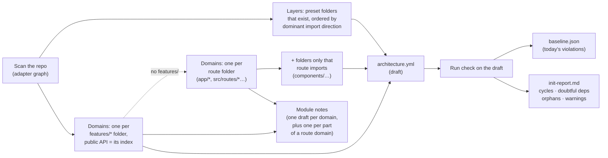
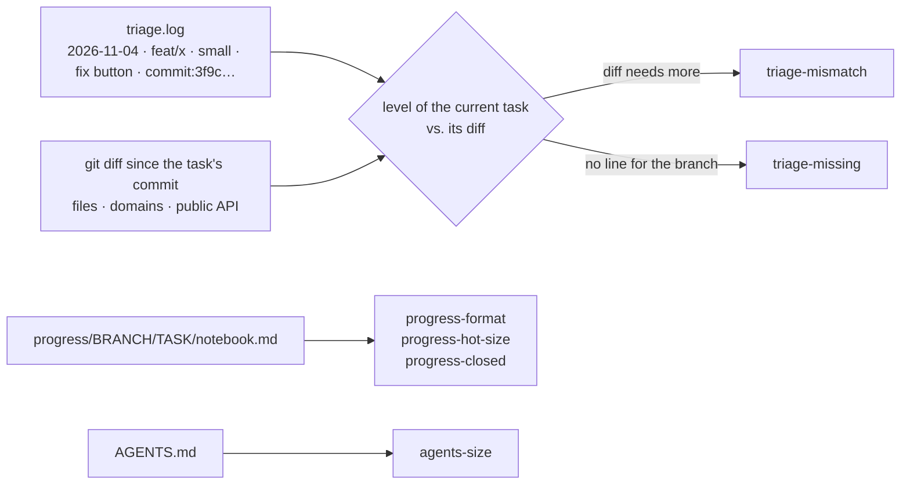
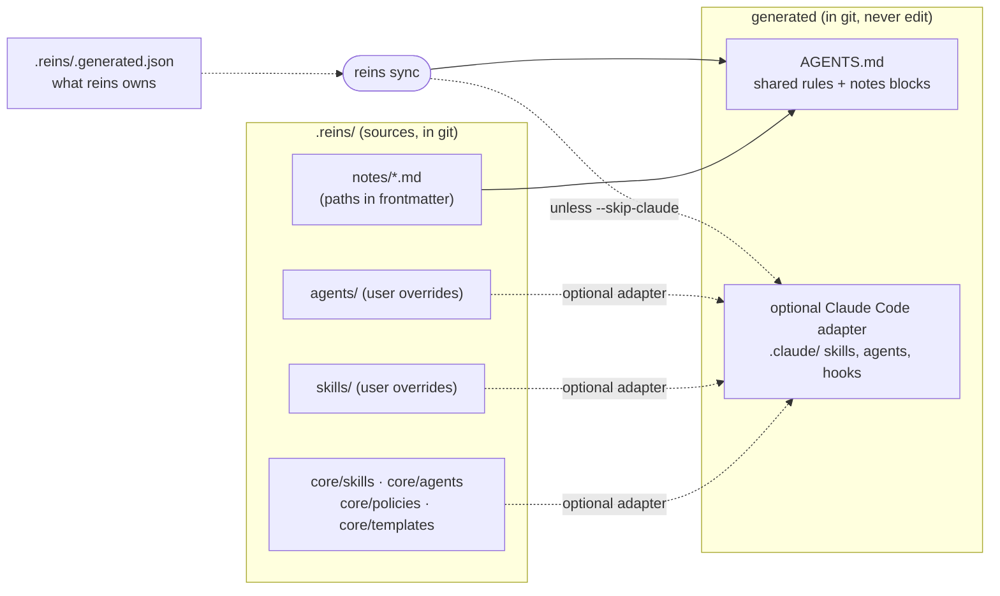
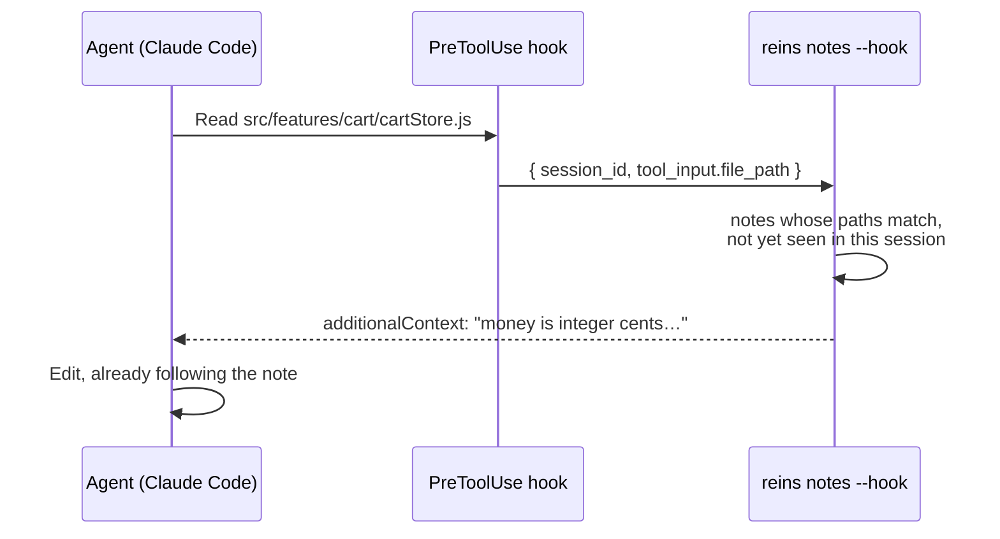
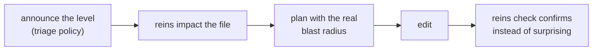
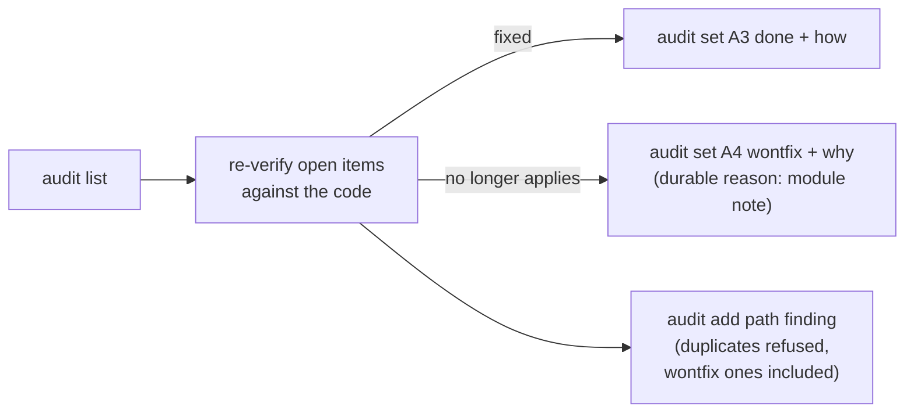

# Commands

> Part of the [README](../README.md): it has the short version, this page the detail.

## `reins init`

Drafts the plan from the code. The code says what exists, not what should exist, so the result is a draft for a person to review.



**Repos organized by routes.** With no `features/*` or `modules/*` folder, each route folder becomes a domain:

- Next route groups `(main)` and parameters `[slug]` are looked through: they share a layout or a URL segment, they are not features. `(companies)/companies/[slug]` gives a domain `companies`, and a route split across groups (`(companies)/companies` and `(main)/companies`, both `/companies`) is one domain with several folders.
- A route folder with a single source file (a lone `page.js`: about, terms…) is left out and listed in the report, unless the graph gives it a folder elsewhere: a thin `routes/dashboard/index.jsx` whose code lives in `components/pages/dashboard/` is a domain. One-file routes that share a feature folder only they use (`routes/notifications/` and `routes/notificationsPreferences/` over `components/pages/notifications/`) become one domain named after that folder.
- A route's logic often lives outside its folder (`components/pages/companies/`, `components/JobBoard/`…). The import graph decides where it belongs, never folder names. Inside a folder organized by feature (`components/pages/`), each subfolder joins, whole, the domain that makes most of its imports; the few imports from elsewhere are frozen in the baseline and counted in the report. A folder that is not organized by feature (`components/shared/`) is shared code, and so is the lowest layer (`utils/`, `constants/`): nothing there is assigned.
- Imports through a re-export file (`import { JobBoard } from '@/components'` with `components/index.js` re-exporting everything) count as imports of the file behind it, so a barrel doesn't make every page look like it uses every component.
- A loose file only one route uses (`components/paginaContacto.js` next to shared ones) goes in that route's note, so the agent gets the context when it opens the file; it never goes into the rules.
- The report says, for each domain, how many imports reach it from outside. A domain whose public API is only route files (`page.js`, `layout.js`) is closed: nothing outside may import its files.

| Option | Effect |
| --- | --- |
| `--preset <name>` | `vite-react`, `next-app` or `next-pages` (default: detected) |
| `--dry-run` | Print the draft and the report, write nothing |
| `--force` | Overwrite existing files without asking (otherwise it asks, or refuses when there is no terminal) |

If the adapter is missing, it prints the install command for your package manager. It never installs anything.

## `reins check`

| Option | Effect |
| --- | --- |
| `--files <a,b>` | Only report violations involving these files (what the pre-commit hook runs) |
| `--json` | Machine-readable output for agents |
| `--base <ref>` | Compare `integrity` with this branch instead of [the usual base](#which-base-reins-compares-with) |
| `--update-baseline` | Freeze the current violations into `baseline.json` |
| `--verbose` | Also list violations already in the baseline |
| `--coverage` | Instead of checking, show what the plan covers: files per layer and domain, folders outside every layer (not checked), imports between layers, exceptions and the baseline. With `--json` for agents |

Exit codes: **0** no new errors · **1** new errors · **2** could not run (config, adapter, options).

## Which base reins compares with

`check` (integrity), `review`, the PR map, `doctor` and `resume` compare the branch with a starting point. reins takes the first one it finds, so nobody has to configure it:

| # | Where it comes from | Used for |
| --- | --- | --- |
| 1 | `--base <ref>` on the command | Everything. The way out when the rest is wrong |
| 2 | The task's `triage.log` line | `doctor` and `resume` only: they look at the task |
| 3 | Where the branch started: git writes it when the branch is created (`git checkout -b`, `git switch -c`). If the branch it came from still exists, the merge base with it, so merging newer staging into the task does not count staging's work | Everything, locally. Not in CI, and not for a branch fetched from someone else, rebased away from its start, or older than the reflog (90 days) |
| 4 | `REINS_BASE` | A person's own default |
| 5 | `GITHUB_BASE_REF` | CI: the pull request's target |
| 6 | `base:` in `architecture.yml` | The team's default, committed. `init` and `update` suggest it when `origin/staging` or `origin/develop` exists |
| 7 | `origin/HEAD`, `origin/main`, `origin/master`, `main`, `master` | Everything else |

Names are used as written: `staging` is your local branch, `origin/staging` GitHub's. A `REINS_BASE` or `base:` that does not exist is skipped with a warning, never silently; a `--base` that does not exist is an error. The output says what it compared with ("Compared with the branch start (from staging)").

## `reins doctor`

Local, informational checks of **how the work is going**, not of the code. It reads files the agent writes, so it only sees what the agent wrote.

|  | `reins check` | `reins doctor` |
| --- | --- | --- |
| Guarantees | What enters git follows the rules | How the local workflow is going |
| Looks at | The code (import graph) | `triage.log`, the progress notebook, `AGENTS.md`, the local diff |
| Result | Blocks on new errors | Warnings only; exit 0 unless `--strict` |
| Runs in | Git hook and CI | Your machine, when the agent closes a task. **Never in CI** (skipped when `CI` is set) |
| Baseline / adapter | Yes / yes | No / no |



| Rule | Warns when |
| --- | --- |
| `triage-missing` | The branch has changes but no line in `triage.log` (or a line can't be read) |
| `triage-mismatch` | The current task's diff exceeds its declared level: `small` = ≤ 3 files in 1 domain; `medium` = 1 domain; more domains, a public API or `architecture.yml` = `large` |

Before reading or searching code, the agent runs `npx reins triage "<reason>"` with no files: reins measures and records nothing, it matches the words of the reason against the module notes (file names, paths, the folders they cover, their text) and prints the likely areas with their notes, so the agent starts from them instead of exploring to find out which files to pass. Plain word matching, no model: the reason should use the names the code uses. A folder name counts even when the note never mentions it (`JobMatches/` for "job matches").

The agent does not guess the level: once it knows the files, it runs `npx reins triage "<reason>" --files <paths it expects to touch>` and reins measures it from those files (domains, public APIs, `architecture.yml`, number of code files; docs and tests are not counted). The agent gives a level only to raise it, when the task is bigger than its files show (`reins triage large "<reason>"` for a new feature or a migration), and reins keeps the higher of the two; `--override` records the level the person chose with `[quick]` or `[deep]`. It also notes the commit the task starts from, and prints the notes of those files the session has not received yet. While the task is in progress, `reins triage` and every `reins progress` edit say when the changes already look bigger than the level. So the doctor looks at **this task's** changes (since that commit, plus uncommitted ones), even on `main` or a long-lived branch where older tasks piled up. `reins resume` tidies the log by itself: lines of deleted branches and of tasks already merged go away.
| `agents-size` | `AGENTS.md` is longer than 45 lines (`sync` keeps its notes index inside this limit) |
| `progress-hot-size` | The hot notebook is longer than 40 lines |
| `progress-format` | Missing header, invalid marker, more than one `[~]`, or a `[-]` without a reason |
| `progress-closed` | `status: closed` with done criteria not checked |
| `note-missing` | A medium or large diff touched a domain that has no module note, or `architecture.yml` changed and a domain has no note |
| `note-outdated` | A medium or large diff changed a module's files but not its note |
| `note-draft` | A note of a touched module still has `TODO` lines from its draft; many drafts make a single warning |
| `note-size` | A note of a touched module is longer than 60 lines |
| `note-layout` | A note of a touched module is more than one folder deep, or is a part whose module note is missing or whose paths are outside that module |
| `note-dead-paths` | Any note: a glob in its `paths` matches no file, so the note may reach nobody (several notes: one warning) |
| `note-dead-refs` | Any note: it names, in backticks, a repo file or folder that no longer exists (several notes: one warning) |
| `note-uncovered` | A medium or large diff changed files in a direct subfolder of a note's `<dir>/**` with at least `notes.uncovered_min_files` files (default 10; 0 turns it off), and the note never names that folder nor does a part note cover it: the next agent would get the note and still explore that folder from scratch |

Thresholds are starting values in `.reins/doctor.yml`; tune them to your team:

```yaml
triage:
  small:  { max_files: 3, max_domains: 1 }
  medium: { max_domains: 1 }
agents_md: { max_lines: 45 }
progress:  { hot_max_lines: 40 }
notes:     { max_lines: 60 }
```

Notebook format (`.reins/progress/<branch>/<task>/notebook.md`, local, outside git; reins writes `task:` and `session:`):

```markdown
# feat/discounts · task: discounts · session: 3f9c… · status: open · updated: 2026-11-04
**Goal:** apply discounts in the cart.
**Done criteria:**
- [ ] discount applied to the total
- [ ] `reins check` without new violations
**Subtasks:**
- [x] model            (written, not tested)
- [~] UI               (in progress: only one)
- [-] coupons — out of scope, ticket 42
**Next step:** wire the UI.
```

## `reins sync`, `reins notes`, `reins scope`, `reins impact`, `reins resume`

`sync` refreshes the provider-neutral core sources and managed `AGENTS.md` blocks. By default it also generates the optional Claude Code adapter; `--skip-claude` updates only the shared files and leaves existing Claude files untouched. It only touches generated files recorded in `.reins/.generated.json`. `--local` writes only the generated files the repo gitignores ([below](#gitignored-generated-files)).



| Situation | What `sync` does |
| --- | --- |
| Third-party skill, agent or setting (e.g. another tool's hook) | Never touched |
| A file at a generated path that reins didn't create | Not touched; warning |
| A generated file edited by hand | Overwritten, with a message (edit the source instead); `--check` fails |
| A source deleted | Its generated files are removed (kept if edited by hand) |
| `AGENTS.md` / `CLAUDE.md` missing | Created from the templates; afterwards they belong to the repo (only marked reins blocks are managed) |
| Notes index | Its first line asks the agent to run `npx reins notes <path…>` before changing a file, then one line per note; hooks are an optional client-specific fast path |
| More notes than fit in `AGENTS.md` | Only that first line and the number of notes, so `AGENTS.md` stays within doctor's `agents_md.max_lines` |
| The repo gitignores generated files (say `.claude/`) | Generates them as usual, and adds `(reins sync --local \|\| exit 0)` to package.json's `prepare` (`postinstall` with yarn), so every install makes them on each machine |

`sync --check` writes nothing and fails if anything differs. Once `.generated.json` exists, `reins check` reports the same differences under `integrity`.

<a id="gitignored-generated-files"></a>**Gitignored generated files.** Committing `.claude/` is the simplest setup, but a repo may gitignore it. Those files can't be in a PR, so `sync --check` and `check` never report them; each machine makes its own:

- `reins sync --local` writes only the generated files git ignores, never a committed file or the manifest. It is silent when nothing changes and always exits 0, because the install script runs it. Before the repo adopted `sync` (no manifest) it does nothing.
- npm, pnpm and bun run the repo's `prepare` on install; yarn 4 only `postinstall`. pnpm runs it on the first install and whenever dependencies change, such as a `reins update`. `|| exit 0` keeps an install without dev dependencies (a Docker image) working.
- If they are still missing or stale, `check` prints one plain warning (not a finding, and none in CI) saying to run `npx reins sync --local`.

**How a module note reaches the agent:**



**The same hook guards shared files.** At session start reins builds an impact map in the background (who imports each file, and the minimum task level if a change breaks them). When the agent opens a shared file that needs a higher level than the one it declared, it gets told to stop, tell you, and re-plan before editing. It says it once per file, and stays quiet when the level already fits.

**Cursor too.** Cursor runs the same hooks from `.claude/settings.json`, so notes, the task notebook and the impact warning reach Cursor's agent as well. `reins sync` adds a one-line `.cursor/hooks.json` that makes Cursor fire its session start; commit it with the rest.

The `AGENTS.md` index line works with any agent (Codex, Cursor); the hook is the Claude Code fast path. Tested with Claude Code: the note arrives when the file is read, so the very first edit already follows it ([details](VERIFIED.md#phase-6-findings)).

`scope` goes **path → domain**: the files a task will touch. `impact` goes the other way, **file → consuming domains**, and answers the question an agent has before touching a shared file: *who else imports this?*



```console
$ npx reins impact src/lib/date.ts
File: src/lib/date.ts (no domain)
Imported by: 2 files — billing (1), no domain (1)
Public API: no
Boundary crossings: none
Existing violations: 1 (no-cycles new; run `reins check --files src/lib/date.ts` to see them)
Notes to read: .reins/notes/lib.md
Minimum level (if the change breaks importers): small (3 file(s) in 1 domain)
```

Boundary crossings are imports that reach a domain's internals instead of its public API — the same leak `domain-boundary` reports, counted with every import kind (a type-only import also breaks when the type changes). Importers that go through a barrel (`import { x } from '@/lib'`) count as consumers of the file behind it, not just of the barrel. Symbol-level questions stay with grep, inside the domains listed. The generated `AGENTS.md` tells agents when to run it (restructuring a domain or folder, or editing a file other code may import), at every task level.

| Command | What it does |
| --- | --- |
| `reins notes <path…>` | Prints the notes that apply to each path |
| `reins notes --hook` | The same, as the Claude Code hook (JSON in/out, once per note and session) |
| `reins notes stale` | Notes ranked by commits to their paths since the note last changed (git history). `--limit <n>` (default 10, 0 for all), `--json` |
| `reins notes new <domain\|folder>` | Drafts `.reins/notes/<name>.md` from the import graph: public API, most imported files, who uses the module, what it depends on. The rest are `TODO` lines to fill in. `--paths` sets the globs, `--force` overwrites |
| `reins resume` | This session's task notebook, one line per other open task on the branch, the files the task changed and their notes: what an agent needs to pick a task up. Also tidies old notebooks and triage lines. `--json` for agents, `--base <ref>` to compare with another branch |
| `reins resume --hook` | The same, as the Claude Code `SessionStart` hook (startup, `/clear`, compaction). After a compaction the notes are delivered again |
| `reins scope <path…>` | Domains, public APIs, notes to read and the minimum task level (`small` / `medium` / `large`) |
| `reins impact <file-or-folder>` | The reverse of `scope`: the domains that consume a file, imports that bypass a public API, violations that already involve it, and the minimum level if the change breaks its importers. `--json` |

## `reins audit`, `reins progress`, `reins review`

Small commands so the agent edits local state **one line at a time** instead of rewriting files (cheaper, and the format can't break).

**`reins audit`**: the audit backlog, so "review the whole project" doesn't start from zero every few weeks.



```markdown
- [open] A1 · 2026-11-04 · `src/lib/format.js` · Cache Intl.NumberFormat per locale.
- [open] [recheck] A2 · 2026-11-04 · `src/features/cart/` · Memoize the totals.
- [wontfix] A3 · 2026-11-04 · `src/api/` · Batch requests. — wontfix 2026-11-06: the API has no batch endpoint
```

| Command | Effect |
| --- | --- |
| `audit list [--status open\|done\|wontfix\|all] [--recheck]` | Show findings (default: open) |
| `audit add <path> <finding>` | New open finding |
| `audit set <id> <status> <reason>` | `done`/`wontfix` need a reason; clears `recheck` |
| `audit recheck <id…> \| open` | Flag findings to verify again |

**`reins progress`**: edits the branch notebook (`.reins/progress/<branch>.md`) and refuses anything that would break its format.

| Command | Effect |
| --- | --- |
| `progress new [--hot]` | Notebook from `.reins/templates/` (mini; `--hot` adds the cold folder). Adapt those templates to your team; a missing one falls back to the packaged default |
| `progress show` | Numbered items |
| `progress add <text> [--criteria]` | `- [ ]` in Subtasks (or Done criteria) |
| `progress start <n>` | `[~]`; any other `[~]` goes back to `[ ]` |
| `progress done <n>` | `[x]` |
| `progress drop <n> <reason>` | `[-] … — reason` (kept, so it isn't proposed again) |
| `progress next <text>` | The "Next step" line |

**`reins review`**: prints a review prompt (instructions, changed files, checklist, notes of the touched paths, diff including uncommitted and untracked files) for any agent. It calls no API; `--executor` is the extension point for a future runner.
