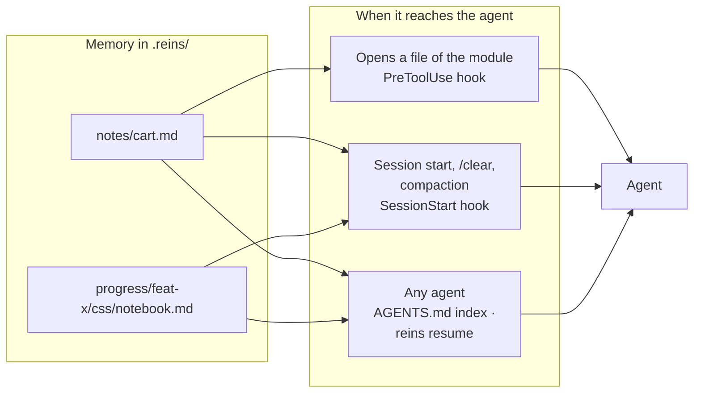
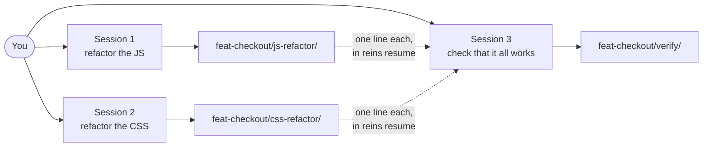
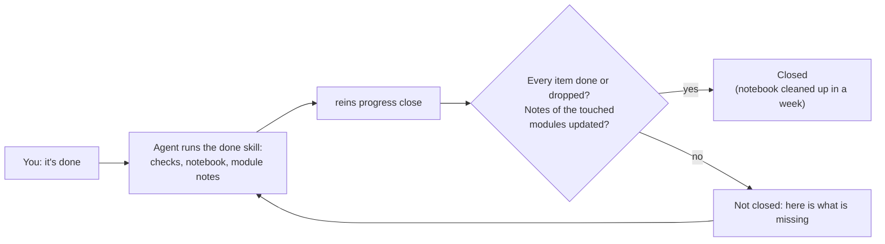
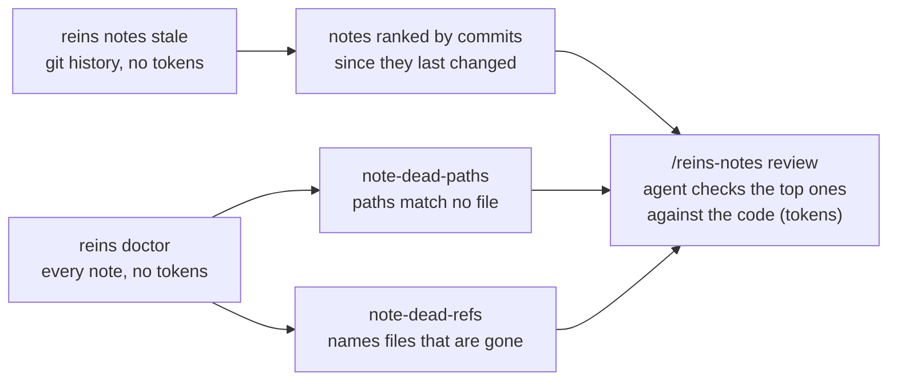
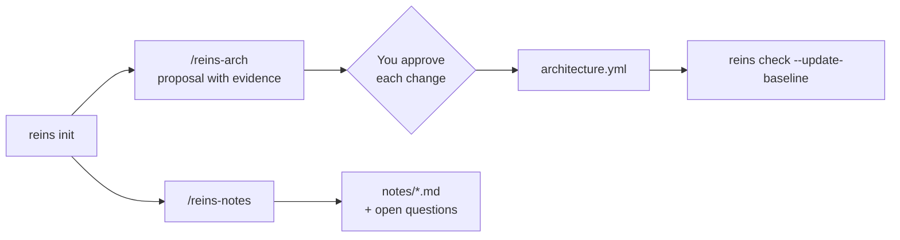

# Context between sessions

> Part of the [README](../README.md): it has the short version, this page the detail.

Two kinds of memory, both plain markdown in `.reins/`:

| | Module note | Task notebook |
| --- | --- | --- |
| File | `.reins/notes/<module>.md`, **in git** | `.reins/progress/<branch>/<task>/notebook.md`, local |
| Lives | As long as the module | As long as the task |
| Holds | Purpose, map, how it works, decisions with their why, traps | Goal, done criteria, subtasks, next step |
| Written by | `reins init` drafts one per domain and `reins notes new` one for any folder; the agent fills in and updates it when closing a task | The agent, one line at a time with `reins progress` |



**Coming back to a module a week later.** The agent opens `src/features/cart/cartStore.js` and, before it edits anything, receives:

```markdown
## Purpose
Cart state and totals for the checkout.

## Map
- Public API: `src/features/cart/index.js`
- `cartStore.js`: the single source of truth; components only read from it.

## Decisions
- 2026-10-28: totals are integer cents. Why: float rounding broke the invoices.

## Traps
- `clear()` keeps the coupon on purpose: the coupon belongs to the session, not to the cart.
```

**What goes in each section.** A note is for someone who has never seen the module and has to change it safely today. If the code already says something clearly, it doesn't go in the note.

| Section | What it is | Example | Doesn't belong |
| --- | --- | --- | --- |
| **Purpose** | What the module does and for whom, in one or two lines. The question it answers: "do I need to touch this module for my task?" | "Cart state and totals for the checkout." | How it does it; history |
| **Map** | Where things are: the public API (the only entry point for other modules) and the key files, one line each on what they are for. `notes new` fills in the parts the import graph knows | "`cartStore.js`: the single source of truth; components only read from it." | A list of every file; what each function does line by line |
| **How it works** | The main flow in a few lines: where the data comes from, what changes it, who reads it. What you'd otherwise rebuild by reading several files | "Components dispatch actions to `cartStore`; `totals.js` recomputes on every change; the checkout page only reads." | Details that are obvious from a single file |
| **Decisions** | Choices that were made on purpose, with a date and **why**, ideally with what was rejected. They stop the next session from "fixing" something that was decided | "2026-10-28: totals are integer cents. Why: float rounding broke the invoices." | Decisions without a why; things that are just how the framework works |
| **Traps** | What looks wrong but is intentional, and invariants that must hold. Where a reasonable change breaks something | "`clear()` keeps the coupon on purpose: the coupon belongs to the session." | General bugs (those go to the backlog) |

A **decision** answers "why is it like this?"; a **trap** warns "careful: this looks wrong, and it isn't". When a decision is reversed, update or delete its line: an outdated note is worse than none.

**A conversation gets compacted.** Claude Code fires the `SessionStart` hook with `compact`; `reins resume --hook` puts back the session's task notebook, the files the task changed and their module notes. Verified with Claude Code: after a compaction the model quoted a notebook and a note that had changed on disk in the meantime ([details](VERIFIED.md#p9-sessionstart-hook-after-a-compaction--pass)). Other agents get the same text with `npx reins resume`.

**Several tasks on one branch.** Talk normally. To work in parallel, open another session and tell it which part is its own ("you do the CSS, the other session is on the JS"). Each task gets its own notebook, so the agents keep the books for you:

- a new session never picks up someone else's task by itself; it creates its own, or continues one when you ask it to;
- each session sees one line per task the others have open, so the session that verifies knows what is in flight;
- when a request overlaps another session's task, the agent asks you before touching it;
- finished notebooks tidy themselves away a week after you close the task.



Each session writes only its own notebook and reads the others. Coming back tomorrow in a new session, just say "continue the CSS work": the agent finds the task and carries on.

**Modules with parts.** A big module keeps the notes of its parts in a folder named after it, one level deep. The module's note holds what every part shares and lists the parts; each part's note holds only what is specific to it. In the `AGENTS.md` index the parts go on their module's line, so it doesn't grow a line per part.

```
.reins/notes/
  auth.md
  companies.md          the module: shared context, lists its parts
  companies/
    salaries.md         a part: only what is specific to salaries
    reviews.md
  jobs.md
```

**Adding one.** `init` drafts a note per domain (a `features/*` folder, or each route folder when there are none). A route domain with several parts (say `(companies)` with `companies/[slug]/salaries`, `reviews`, `jobs`…) also gets one note per part with two or more source files, up to 12 per domain. Notes stack: an agent working in `salaries/` reads the `companies` note first, for the shared context, and then the `salaries` note, for what is specific there. Parts are only notes, not domains, so they add no rules. For any other module, `reins notes new <folder>` drafts one (a folder inside a domain becomes one of its parts), or write `.reins/notes/<name>.md` yourself: only the `paths` frontmatter is required, and it decides when the note is delivered, so include the module's folders outside its route too (e.g. `src/components/jobs/**`). Then run `reins sync` to list it in the `AGENTS.md` index; the Claude Code hook reads `.reins/notes/` directly, so it delivers the note right away.

**Filling them in.** `/reins-notes` (a Claude Code skill installed by `reins sync`) has the agent read each module and replace the `TODO` lines. It writes only decisions it can back up (code, comments, git history) and leaves the rest as `- ? question` lines for you to answer.

**Notes stay current.** The `reins-done` skill updates the notes of the modules a task touched, and `reins doctor` warns when a medium or large task changed a module without touching its note, or touched a domain that has no note. Closing makes sure of it: when you say "done", the agent closes the task with `reins progress close`, and reins only closes it once nothing in the notebook is left pending and those notes are updated. Otherwise it answers with what is missing, so what the agent learned is never lost when the notebook is cleaned up.



When a flagged note really needs nothing (a version bump, say), the agent closes with `--notes-ok "<why>"` and the reason stays in the notebook.

**Catching notes that fell behind.** Code moves on in small fixes too, which never trigger the warnings above. Three checks cover that, from free to paid:



`note-dead-paths` matters most: a note whose paths match nothing reaches nobody, silently. `reins notes stale` is a signal, not proof; the review is what checks that a note is still true, and it only runs when you ask for it.

## How the skills fit in

After `init`, two skills turn the drafts into something you can trust; you approve the architecture changes one by one.



Your own agents and skills follow the same path: write them in `.reins/agents/` or `.reins/skills/` (or ask `/reins-agent`), run `reins sync`.
