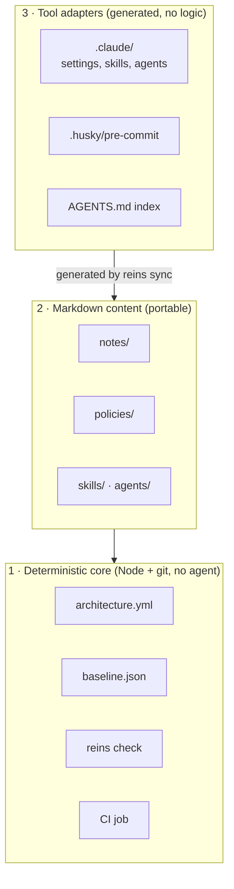
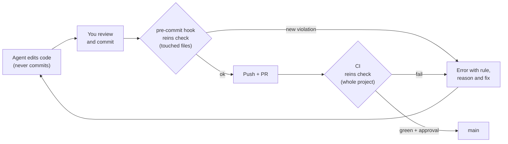
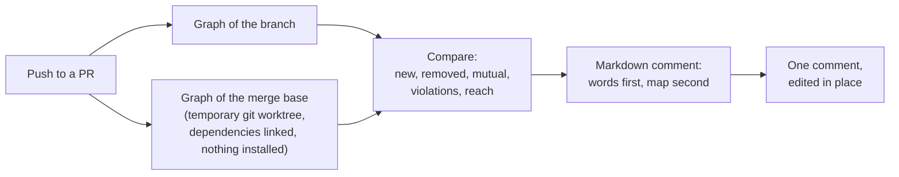
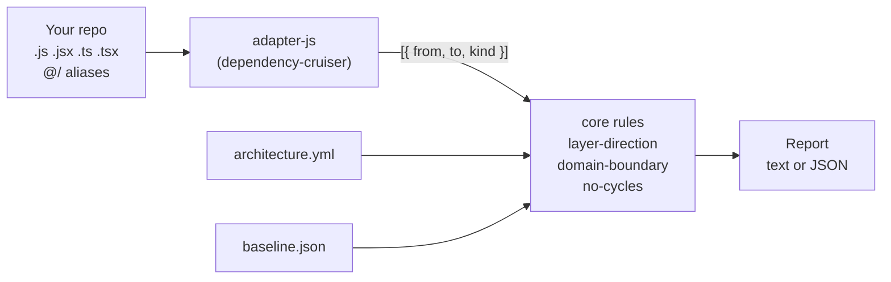
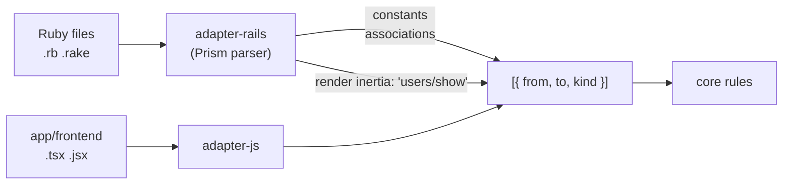
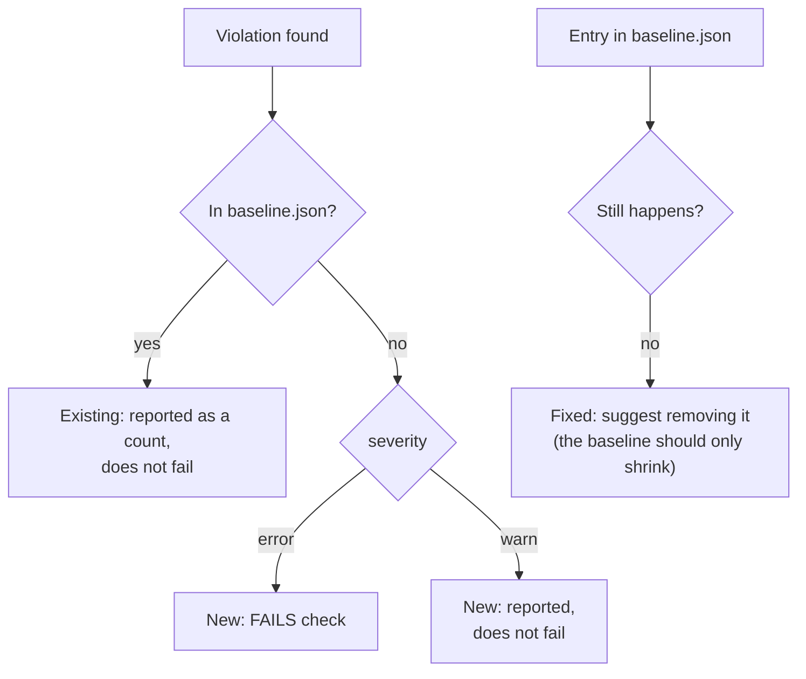
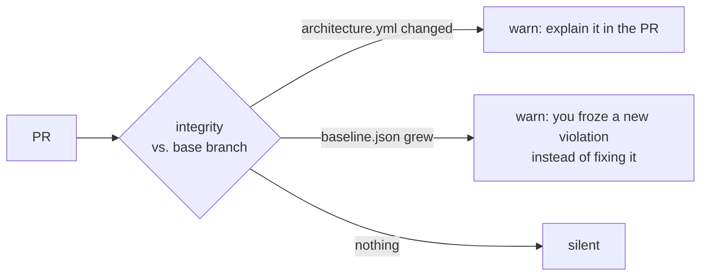
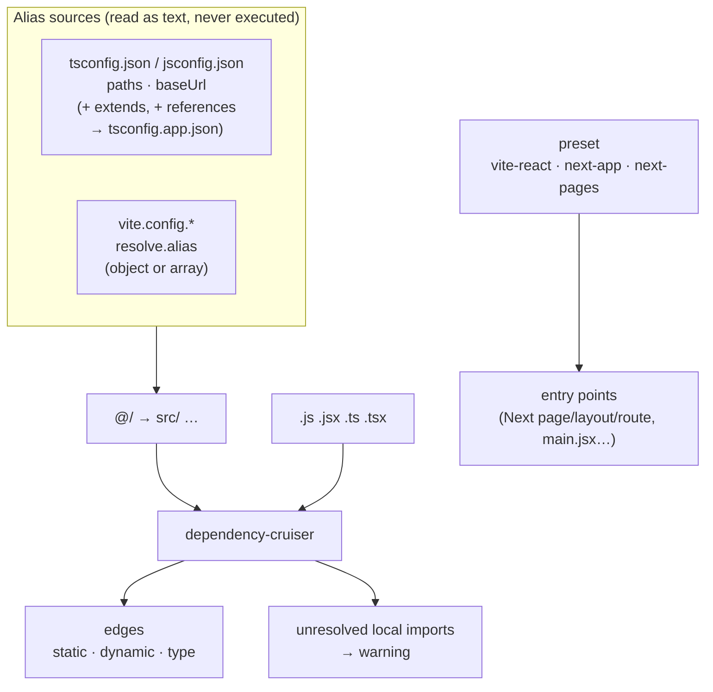
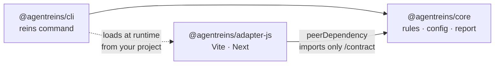

# How it works

> Part of the [README](../README.md): it has the short version, this page the detail.

## Three layers

From most to least durable. Each layer only depends on the ones below it.



Each layer is optional: if one doesn't pay off for your team, delete it and the others keep working. Layer 3 is meant to be thrown away and regenerated when agent tools change their formats.

## What happens on a commit



The hook can be skipped with `--no-verify`, so **CI plus branch protection is the real guarantee**. The hook is there to fail fast.

## The architecture map on every pull request

A text diff hides the shape of the change: one new import between two domains is a single line among hundreds. So the CI job also posts **one comment per PR** that shows, before anyone opens a file, how the PR changes the structure: new and removed dependencies between domains, new domains, folders no rule covers, violations, and which domains import the changed code. It is plain templates filled with data (no AI, no API besides posting the comment), and it is edited in place on every push. A PR that changes no structure gets a short version with one line, so the full comment stands out when it matters.



In a repo with several languages (`adapters: [rails, js]`), the map draws **one frame per language**. An arrow between two frames is a dependency that crosses languages, such as a Rails controller that renders a React page. A domain with code on both sides appears once in each frame, and the text says which side: `accounts (rails) now uses billing (js)`.

You can see the same comment locally with `npx reins review --map`. To skip it on one PR, add the label `reins:no-map`; to turn it off for the repo, delete the "Architecture map comment" step from `.github/workflows/reins.yml` (ask your agent). Repos installed before this feature keep their old workflow: paste the step from [`templates/.github/workflows/reins.yml`](../templates/.github/workflows/reins.yml), because `install` never rewrites it. It is experimental: see [`docs/STATUS.md`](STATUS.md) and [`docs/VERIFIED.md`](VERIFIED.md#p14-base-graph-through-a-git-worktree--pass-with-a-mirrored-node_modules).

## How `check` sees your code

The core never opens a `.js` file. A language adapter turns the repo into a list of edges, and the core applies the rules to that list.



A Rails app has no imports to read, so `adapter-rails` finds the dependencies in the constants each file names. With Inertia it also links each controller to the page it renders, and both adapters feed the same rules:



Rules:

| Rule | Fails when | Example |
| --- | --- | --- |
| `layer-direction` | A layer imports from a layer above it | `components/Button` imports from `features/billing` |
| `domain-boundary` | Code imports a domain's internals instead of its public API | `features/search` imports `features/billing/total.js` instead of `features/billing/index.js` |
| `no-cycles` | Modules import each other in a loop | `a → b → c → a` |
| `next-server-client` (optional, Next) | A `'use client'` component reaches a module that imports `server-only` or `next/headers` | `OrderList.tsx` (client) → `queries.ts` → `lib/db.ts` (`import 'server-only'`) |

Plus `integrity`, which warns when a PR changes `architecture.yml` or makes `baseline.json` grow (see below).

## Reading a report

Every finding says **which rule**, **why** and **how to fix it**, so an agent can fix it without asking:

```
✖ error layer-direction  src/components/PriceTag.js → src/features/billing/index.js
    Why: src/components/PriceTag.js (components) imports src/features/billing/index.js (features), but features is above components.
    Fix: Move what src/components/PriceTag.js needs from features down to components or a lower layer, or invert the dependency (pass it in as props or callbacks).

✖ error no-cycles  src/lib/a.js → src/lib/b.js
    Why: Import cycle: src/lib/a.js → src/lib/b.js → src/lib/c.js → src/lib/a.js.
    Fix: Break the cycle: move the code both sides need into a lower module, or invert one of the imports.

reins check: 2 new (2 errors, 0 warnings) · 0 in baseline · 0 fixed
Result: FAIL (new errors)
```

With `--json` the same data comes as JSON with a stable `schema` number, one object per finding: `rule`, `severity`, `status` (`new` / `baseline`), `from`, `to`, `message`, `fix`.

## Baseline: start green, only fail on new problems

A real repo already has violations. Fixing them all before adopting reins isn't realistic, so they are frozen in `baseline.json` and `check` only fails on **new** ones.





- **Baseline** = existing mess to fix someday. **`allow:`** = a decision, with a reason, that stays.
- `integrity` is `warn` by default; set it to `error` in `architecture.yml` to make those changes block.

Full reference of the file, rules, globs and defaults: [`docs/architecture-yml.md`](architecture-yml.md).

## How the JS adapter reads your project

Aliases are the most likely source of silent bugs: if `@/features/x` doesn't resolve, that edge disappears and `check` can't see the violation. So the adapter reads them itself and **warns** about anything it can't resolve.



| Project | Works | Notes |
| --- | --- | --- |
| Vite + React, **plain JS/JSX** | ✅ | Nothing extra to install. Aliases from `jsconfig.json` or `vite.config.js` |
| Vite + React, TypeScript | ✅ | Needs `typescript` in the repo (it already is). Reads `tsconfig.app.json` through `references` |
| Next app router (JS or TS) | ✅ | `page`, `layout`, `route`… are entry points, not orphans |
| Next pages router (JS or TS) | ✅ | Every file under `pages/` is an entry point |

TypeScript repos use the `typescript` package they already have. If it's missing, the adapter says so clearly instead of skipping `.ts` files, so a green `check` always means the whole repo was checked.

## Packages and dependency direction



- `core` knows no framework and never imports `cli` or an adapter.
- Adapters only see `@agentreins/core/contract` (enforced by the `exports` field).
- Adapters are installed separately; if one is missing, the CLI tells you which one. It never installs anything.
- `@agentreins` is the npm organization of every package; the command is `reins`.
## What lands in your repo

After installing, a consumer repo gets this. Files marked *local* stay out of git.

```
your-repo/
├── AGENTS.md                      # ≤ 45 lines: commands, golden rules, path → note index (generated)
├── CLAUDE.md                      # one line: @AGENTS.md
├── .reins/
│   ├── architecture.yml           # layers, domains, rules, exceptions  ← you decide this
│   ├── baseline.json              # frozen existing violations
│   ├── doctor.yml                 # doctor thresholds
│   ├── notes/<module>.md          # per module: purpose, map, how it works, decisions, traps
│   ├── policies/                  # triage, progress, multiagent
│   ├── skills/  agents/           # sources for .claude/skills and .claude/agents
│   ├── review/checklist.md
│   ├── hooks/pre-commit.sh        # one line: reins check
│   ├── backlog/                   # local: audit findings
│   └── progress/                  # local: triage.log and one notebook per task (<branch>/<task>/)
├── .claude/                       # generated by reins sync, no logic of its own
├── .husky/pre-commit              # calls .reins/hooks/pre-commit.sh
└── .github/workflows/reins.yml  # CI job: reins check
```

Example `architecture.yml`:

```yaml
version: 1
adapters: [js]
preset: next-app

layers:                       # each layer may only import from the layers below it
  - { name: pages,      paths: ["src/app/**"] }
  - { name: features,   paths: ["src/features/**"] }
  - { name: components, paths: ["src/components/**"] }
  - { name: shared,     paths: ["src/hooks/**", "src/utils/**", "src/lib/**"] }

domains:
  billing: { paths: ["src/features/billing/**"], public_api: ["src/features/billing/index.js"] }

rules:
  - { id: layer-direction, severity: error }
  - { id: domain-boundary, severity: error }
  - { id: no-cycles,       severity: error }

allow:
  - { from: "src/features/search/**", to: "src/features/billing/**",
      reason: "Search shows prices; decided 2026-11" }
```

```
pages        ─┐
features      │  imports only go downwards
components    │
shared       ─┘
```
