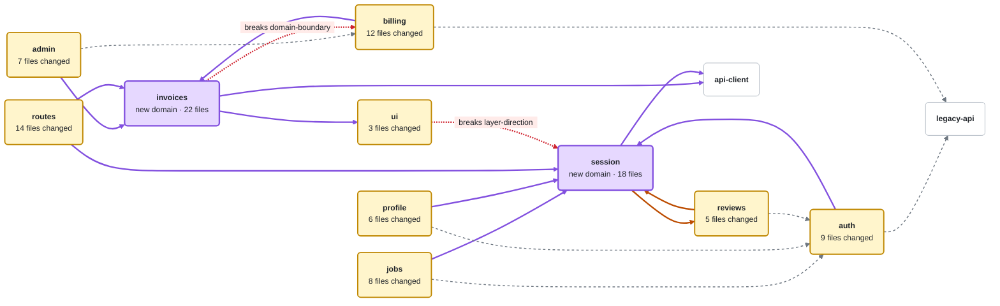

<!-- reins:pr-map -->
### Architecture changes

**2 new domains** · **12 new dependencies** · **6 removed** · **1 mutual dependency** · **2 violations**

<sub>Compared with `main` at `c08e5d4` · 142 files</sub><br>
<sub>7 touched domains have no structural change and are not on the map: see Files by domain.</sub><br>
<sub>7 affected domains are not on the map (64 files import changed code): see Details.</sub>

> [!CAUTION]
> **domain-boundary:** `invoices/totals.ts` imports `billing/internal/tax.ts`. Import from billing's public API (`billing/index.ts`) instead.<br>
> **layer-direction:** `shared/ui/SessionBadge.tsx` imports `session/current.ts`. Shared code must not depend on a feature: pass the session in as a prop.

> [!WARNING]
> **Mutual dependency:** `reviews` and `session` now use each other (`reviews/ReviewForm.tsx` imports `session/index.ts`, `session/SessionGate.tsx` imports `reviews/ReviewPrompt.tsx`). Neither can change without the other. No rule blocks it; decide if it is intended.



<sub>**Boxes:** &nbsp; 🟨 Touched &nbsp; 🟪 New &nbsp; ⬜ Unchanged</sub><br>
<sub>**Lines:** &nbsp; the arrow points to the code being used (invoices → billing: invoices uses billing) &nbsp; 🟪 New &nbsp; 🟧 Mutual &nbsp; 🟥 Breaks a rule &nbsp; ┈┈ Removed</sub>

```diff
- invoices  now uses        billing internals  ✖ breaks domain-boundary
- ui        now uses        session            ✖ breaks layer-direction
! reviews   now uses        session            ⇄ mutual: session also uses reviews
! session   now uses        reviews            ⇄ mutual: reviews also uses session
+ admin     now uses        invoices
+ auth      now uses        session
+ billing   now uses        invoices
+ invoices  now uses        api-client
+ invoices  now uses        ui
+ jobs      now uses        session
+ profile   now uses        session
+ routes    now uses        invoices
+ routes    now uses        session
+ session   now uses        api-client
  admin     no longer uses  billing
  auth      no longer uses  legacy-api
  billing   no longer uses  legacy-api
  jobs      no longer uses  auth
  profile   no longer uses  auth
  reviews   no longer uses  auth
```

<details>
<summary><b>Details</b> (20)</summary>

| Change | Where |
| --- | --- |
| New domain | `invoices` added to architecture.yml (`src/features/invoices/**`) |
| New domain | `session` added to architecture.yml (`src/features/session/**`) |
| New dependency | `admin → invoices`: `admin/Billing.tsx` imports `invoices/index.ts` |
| New dependency | `auth → session`: `auth/login.ts` imports `session/index.ts` |
| New dependency | `billing → invoices`: `billing/checkout.ts` imports `invoices/index.ts` |
| New dependency | `invoices → api-client`: `invoices/fetch.ts` imports `api-client/index.ts` |
| New dependency | `invoices → ui`: `invoices/InvoiceTable.tsx` imports `ui/index.ts` |
| New dependency | `jobs → session`: `jobs/JobList.tsx` imports `session/index.ts` |
| New dependency | `profile → session`: `profile/useUser.ts` imports `session/index.ts` |
| New dependency | `routes → invoices`: `app/billing/invoices/page.tsx` imports `invoices/index.ts` |
| New dependency | `routes → session`: `app/layout.tsx` imports `session/index.ts` (+3 more) |
| New dependency | `session → api-client`: `session/refresh.ts` imports `api-client/index.ts` |
| Mutual | `reviews ⇄ session`: `reviews/ReviewForm.tsx` imports `session/index.ts`; `session/SessionGate.tsx` imports `reviews/ReviewPrompt.tsx` |
| Removed dependency | `admin → billing`: last import removed from `admin/Billing.tsx` |
| Removed dependency | `auth → legacy-api`: last import removed from `auth/token.ts` |
| Removed dependency | `billing → legacy-api`: last import removed from `billing/charge.ts` |
| Removed dependency | `jobs → auth`: last import removed from `jobs/JobList.tsx` |
| Removed dependency | `profile → auth`: last import removed from `profile/useUser.ts` |
| Removed dependency | `reviews → auth`: last import removed from `reviews/ReviewForm.tsx` |
| Affected | `search` (18), `settings` (14), `reports` (11), `onboarding` (9), `messages` (6), `notifications` (4), `analytics` (2) |

</details>

<details>
<summary><b>Files by domain</b> (142)</summary>

| Domain | Files | |
| --- | --- | ---: |
| `invoices` · new | `index.ts`, `totals.ts`, `pdf.ts`, … | 22 |
| `session` · new | `index.ts`, `current.ts`, `refresh.ts`, … | 18 |
| `routes` | `app/layout.tsx`, `app/(auth)/login/page.tsx`, `app/billing/invoices/page.tsx`, … | 14 |
| `billing` | `checkout.ts`, `index.ts`, `charge.ts`, … | 12 |
| `auth` | `login.ts`, `token.ts`, `index.ts`, … | 9 |
| `jobs` | `JobList.tsx`, `query.ts`, `index.ts`, … | 8 |
| `admin` | `Billing.tsx`, `Users.tsx`, `index.ts`, … | 7 |
| `profile` | `useUser.ts`, `Profile.tsx`, `index.ts`, … | 6 |
| `reviews` | `ReviewForm.tsx`, `ReviewList.tsx`, `index.ts`, … | 5 |
| `ui` | `SessionBadge.tsx`, `index.ts`, `Avatar.tsx` | 3 |
| 7 more domains | no structural change | 38 |

</details>

<sub>Generated by reins on every push · `check` result is in the reins job</sub>
