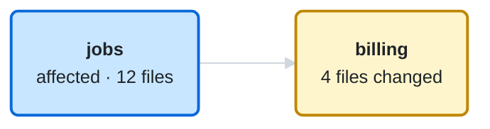

<!-- reins:pr-map -->
### Architecture changes

**No structural changes**

Compared with `main` at `7b41d02` · 4 files

**Boxes:** &nbsp; 🟨 Touched &nbsp; 🟦 Affected 
**Lines:** &nbsp; the arrow points to the code being used (jobs → billing: jobs uses billing) &nbsp; ── Unchanged

<b>Files by domain</b> (4)

| Domain | Files | |
| --- | --- | ---: |
| `billing` | `invoice/totals.ts`, `invoice/round.ts`, `invoice/totals.test.ts`, … | 4 |

Generated by reins on every push · `check` result is in the reins job
