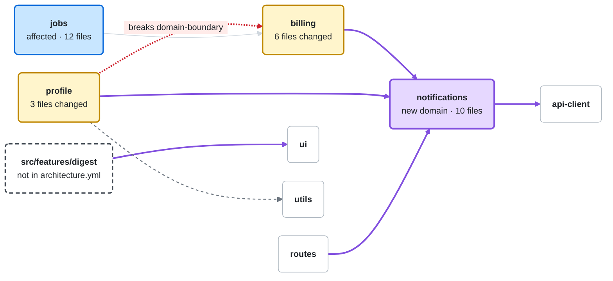

<!-- reins:pr-map -->
### Architecture changes

**1 new domain** · **5 new dependencies** · **1 removed** · **1 folder outside architecture.yml** · **1 violation**

<sub>Compared with `main` at `9a1e07b` · 23 files · touched: `billing`, `profile` · affected: `jobs` (12 files import changed code)</sub>

> [!CAUTION]
> **domain-boundary:** `profile/PlanBadge.tsx` imports `billing/internal/plans.ts`. Import from billing's public API (`billing/index.ts`) instead.



<sub>**Boxes:** &nbsp; 🟨 Touched &nbsp; 🟦 Affected &nbsp; 🟪 New &nbsp; ⬜ Unchanged &nbsp; ⬚ Not in architecture.yml</sub><br>
<sub>**Lines:** &nbsp; the arrow points to the code being used (profile → billing: profile uses billing) &nbsp; 🟪 New &nbsp; 🟥 Breaks a rule &nbsp; ┈┈ Removed &nbsp; ── Unchanged</sub>

```diff
- profile              now uses        billing internals  ✖ breaks domain-boundary
+ billing              now uses        notifications
+ notifications        now uses        api-client
+ profile              now uses        notifications
+ routes               now uses        notifications
+ src/features/digest  now uses        ui                 (src/features/digest is not in architecture.yml)
  profile              no longer uses  utils
```

<details>
<summary><b>Details</b> (9)</summary>

| Change | Where |
| --- | --- |
| New domain | `notifications` added to architecture.yml (`src/features/notifications/**`) |
| Not in architecture.yml | `src/features/digest/` (4 files): no domain covers it, so no rule checks it |
| New dependency | `billing → notifications`: `billing/changePlan.ts` imports `notifications/index.ts` |
| New dependency | `notifications → api-client`: `notifications/send.ts` imports `api-client/index.ts` |
| New dependency | `profile → notifications`: `profile/Settings.tsx` imports `notifications/index.ts` |
| New dependency | `routes → notifications`: `app/settings/notifications/page.tsx` imports `notifications/index.ts` |
| New dependency | `src/features/digest → ui`: `src/features/digest/DigestCard.tsx` imports `ui/index.ts` |
| Removed dependency | `profile → utils`: last import removed from `profile/format.ts` |
| Affected | `jobs` (12) |

</details>

<details>
<summary><b>Files by domain</b> (23)</summary>

| Domain | Files | |
| --- | --- | ---: |
| `notifications` · new | `index.ts`, `send.ts`, `preferences.ts`, … | 10 |
| `billing` | `changePlan.ts`, `index.ts`, `plans.ts`, … | 6 |
| no domain | `src/features/digest/*` | 4 |
| `profile` | `PlanBadge.tsx`, `format.ts`, `Settings.tsx` | 3 |

</details>

<sub>Generated by reins on every push · `check` result is in the reins job</sub>
