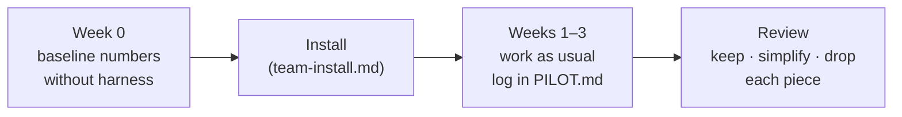

# Team adoption: the pilot

How the team tries the harness and decides, with numbers, what stays. Two or three weeks, one or two repos.

## 1. Before starting (week 0)

- Pick one or two repos that get agent-written changes every week.
- Copy [`PILOT.md`](PILOT.md) to the pilot repo (outside `.harness/`, e.g. `docs/PILOT.md`) and fill in the "before" column from the last 2–3 weeks of PRs.
- **Decide the thresholds now**, before seeing results (the table in `PILOT.md`). Deciding afterwards turns any result into "it worked".
- Measure startup tokens without the harness (see below).

## 2. Setup (day 1)

Follow [`team-install.md`](team-install.md): tarballs in `vendor/harness/`, `harness install`, `harness init`, review the plan **as a team** (it's the architecture you'll enforce), freeze the baseline, commit, protect the main branch.

## 3. During the pilot

Work as usual. A few habits make the numbers possible:

- Agents announce the task level and append it to `.harness/progress/triage.log` (the `AGENTS.md` rules ask for it).
- At the end of each task, run `harness doctor` and note mismatches in `PILOT.md`.
- When you have to re-explain a task to an agent after a pause or a new session, add a tally in `PILOT.md`.
- Count the review rounds of each PR (comments asking for changes, then a new push = one round).

## 4. Metrics

| Metric | How to measure | Why |
| --- | --- | --- |
| Architecture violations reaching the PR | CI `harness` job failures per PR; before the pilot, count by hand in recent PRs (`harness check` on old commits helps) | The core promise: problems caught before review |
| Review rounds per PR | Count in the PR history | Does guidance (notes, policies) reduce back-and-forth? |
| Times a task had to be re-explained | Tally in `PILOT.md` | Does the notebook survive pauses and context compaction? |
| Triage hits and misses | `triage.log` vs. `harness doctor` (`triage-mismatch`, `triage-missing`) | Is the level the agent picks right? It drives token use |
| Startup tokens with and without the harness | Same prompt in a fresh session, with and without `AGENTS.md`/notes; read the input tokens of the first turn (Claude Code's usage dashboard or `claude -p --output-format json`) | Guidance must cost less than it saves |
| Tokens spent keeping the notebook | Tokens of turns that only edit `.harness/progress/` | The notebook isn't free |

Keep the metrics independent of the model and tool, so the comparison survives a model change or a switch to Codex or Cursor. Cursor and Codex don't share Claude Code's token logs: note which tool each number comes from.

## 5. Decide

For each piece, before the pilot, write down what result means **keep**, **simplify** or **drop** (in `PILOT.md`). Examples:

| Piece | Keep if | Drop if |
| --- | --- | --- |
| `check` + hook + CI | Violations reaching PRs go down, false positives are rare | The team keeps adding `allow:` to silence it |
| Triage + doctor | Mismatches < 1 in 4 tasks and small tasks get cheaper | Agents don't log, or mismatches stay high |
| Notebook | Re-explanations go down | Nobody resumes from it, or it costs more tokens than it saves |
| Module notes | Fewer review comments on the noted modules | Notes go stale |
| Audit backlog | The second audit reuses the first | Nobody runs audits |

Everything except `check` is optional by design: dropping a piece doesn't break the others (delete its files and run `harness sync`).
