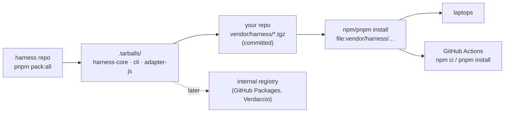

# Installing the harness in the team's repos (without publishing)

The packages are not on npm yet. This is how the team installs them anyway, so that **CI can install them too**.



## Option A (recommended now): tarballs committed in the repo

Verified with npm and pnpm: a fresh clone in another folder installs with `npm ci` / `pnpm install --frozen-lockfile` and `harness check` runs ([`scripts/verify/vendor-test.sh`](../scripts/verify/vendor-test.sh), [`vendor-test-pnpm.sh`](../scripts/verify/vendor-test-pnpm.sh)).

> [!WARNING]
> Don't install from a path outside the repo (e.g. `~/harness/.tarballs/…`): the lockfile records that path and CI can't reach it. That's fine for [trying it](try-it.md), not for the team.

1. In the harness repo: `pnpm install && pnpm pack:all`.
2. In your repo: copy the three files from `.tarballs/` to `vendor/harness/` and commit them (~70 KB in total).
3. Install them:

   **npm**
   ```bash
   npm install -D ./vendor/harness/harness-core-0.1.0.tgz \
                  ./vendor/harness/harness-cli-0.1.0.tgz \
                  ./vendor/harness/harness-adapter-js-0.1.0.tgz
   ```

   **pnpm**: add to `pnpm-workspace.yaml` (pnpm doesn't read the `pnpm` field of `package.json` anymore):
   ```yaml
   overrides:
     "@harness/core": "file:vendor/harness/harness-core-0.1.0.tgz"
   ```
   ```bash
   pnpm add -D ./vendor/harness/harness-cli-0.1.0.tgz ./vendor/harness/harness-adapter-js-0.1.0.tgz
   ```

   **yarn**: not tested.

4. `npx --no-install harness install`, then `npx --no-install harness init`. See the [README](../README.md#installation).

**Updating:** pack again, replace the files in `vendor/harness/` (the version in the file name changes with each release), run the same install command, commit. Everyone gets it on their next install.

## Option B (later): an internal registry

Unverified. Two common choices:

| Registry | Notes |
| --- | --- |
| GitHub Packages (npm) | The scope must be the GitHub organization (e.g. `@acme/harness-cli`): rename it first with `pnpm rename-scope @acme`. Each developer and CI need a token with `read:packages` in `.npmrc` |
| Verdaccio (self-hosted) | Any scope. Someone has to run and secure the server |

Then `npm publish` from each package folder (never done by an agent), and consumers install with normal version ranges.

## What each repo ends up with

| Path | In git | Who writes it |
| --- | --- | --- |
| `vendor/harness/*.tgz` | yes | you (option A) |
| `.harness/architecture.yml`, `baseline.json` | yes | `harness init`, then people |
| `.harness/policies/`, `skills/`, `agents/`, `templates/`, `review/`, `hooks/`, `doctor.yml`, `notes/` | yes | `harness install`, then people |
| `.harness/.generated.json`, `.claude/`, `AGENTS.md`, `CLAUDE.md` | yes | `harness sync` (and people for `AGENTS.md` outside the notes block) |
| `.husky/pre-commit` or `lefthook.yml` entry | yes | `harness install` |
| `.github/workflows/harness.yml` | yes | `harness install` |
| `.harness/backlog/`, `.harness/progress/`, `.harness/init-report.md` | **no** | the agent, locally |

## Branch protection (the real guarantee)

The pre-commit hook can be skipped. In GitHub → Settings → Branches (or Rulesets) for the main branch:

- Require a pull request before merging, with at least one approval.
- Require status checks to pass: select the **harness** job (it appears after its first run).
- Don't allow bypassing the rules (or limit who can).
