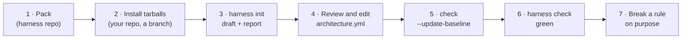

# Try `init` and `check` on a real repo

How to **try** `init` and `check` on one of your repos, on a throwaway branch, without wiring anything else. Nothing is installed globally and nothing is committed for you. To adopt the harness for real (hook, CI, agent files), follow [`team-install.md`](team-install.md) and `harness install` instead.



## 1. Pack the packages (in this repo)

```bash
pnpm install
pnpm pack:all          # writes .tarballs/harness-{core,cli,adapter-js}-<version>.tgz
```

## 2. Install them in your repo (on a throwaway branch)

Use the absolute path to `.tarballs/` printed by the previous step.

**npm** (verified):

```bash
git switch -c try-harness
npm install -D /path/to/harness/.tarballs/harness-core-0.0.0.tgz \
               /path/to/harness/.tarballs/harness-cli-0.0.0.tgz \
               /path/to/harness/.tarballs/harness-adapter-js-0.0.0.tgz
```

**pnpm** (verified): pnpm would look for `@harness/core` in the npm registry, where it doesn't exist. Point it to the tarball with an override in `pnpm-workspace.yaml` (create the file if the repo doesn't have one; pnpm 10+ ignores the `pnpm` field of `package.json`):

```yaml
overrides:
  "@harness/core": "file:/path/to/harness/.tarballs/harness-core-0.0.0.tgz"
```

```bash
git switch -c try-harness
pnpm add -D /path/to/harness/.tarballs/harness-cli-0.0.0.tgz /path/to/harness/.tarballs/harness-adapter-js-0.0.0.tgz
```

**yarn**: not tested yet.

TypeScript repos need `typescript` installed (they already have it). Plain JS repos need nothing else.

## 3. Draft the plan

```bash
npx harness init          # or: pnpm exec harness init
```

It writes three files and never overwrites existing ones without asking (`--dry-run` to preview, `--force` to overwrite):

| File | What | Commit it? |
| --- | --- | --- |
| `.harness/architecture.yml` | Draft plan: layers, domains, rules | Yes, after review |
| `.harness/baseline.json` | Violations that exist today, frozen | Yes |
| `.harness/init-report.md` | Review report | No (delete it or add it to `.gitignore`) |

## 4. Review the report and fix the plan

Open `.harness/init-report.md`. It shows:

- **Layers** found and their order, with the evidence (imports going down vs. up). Mixed pairs are marked: check that order.
- **Folders outside every layer**: add them to a layer in `architecture.yml`, or leave them unchecked.
- **Domains** (one per `features/*` folder) and their public API. "No index file" means the domain has no `index.*`.
- **Cycles**, **doubtful dependencies** (imports that break the draft) and **orphans** (possibly dead code).
- **Warnings**: especially imports that could not be resolved. Those are invisible to `check`; fix the alias config if there are many.

The draft describes what exists. If the repo is messy, the draft is messy: **you** decide the architecture. Reference: [`architecture-yml.md`](architecture-yml.md).

## 5. Freeze the violations of your final plan

```bash
npx harness check --update-baseline
```

## 6. Check

```bash
npx harness check         # must say "no new violations" and exit 0
npx harness check --json  # what an agent would read
```

## 7. Break a rule on purpose

Add an import that goes upwards (e.g. a component importing from a feature), then:

```bash
npx harness check --files src/components/Whatever.jsx   # what the pre-commit hook will run
```

It must fail with the rule, the reason and the fix. Undo the change.

## What to tell us

Please write down, roughly:

1. Did `init` run? How long did `init` and `check` take, and how many files does the repo have?
2. Were the layers and their order right? What did you change in `architecture.yml`?
3. Were the domains right?
4. How many violations went to the baseline, and did they look real or like false positives?
5. Any warnings about unresolved imports? Which aliases does the repo use?
6. Anything confusing in the messages or the report.

To undo everything: `git switch -` and delete the branch.
