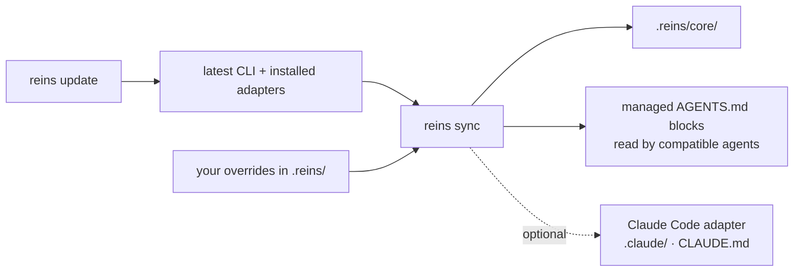

# Updating

> Part of the [README](../README.md): it has the short version, this page the detail.

```bash
# 1. Update the CLI and installed adapters, then sync the new core templates
npx reins update                   # preference persists; use --skip-claude or --claude to change it

# 2. Check the local workflow
npx reins doctor
npx reins check

# 3. Notes that fell behind their code (git history, no tokens);
#    review the top ones with /reins-notes review
npx reins notes stale
```

The shared workflow is provider-neutral: reins stores its rules in Markdown, exposes them through `AGENTS.md`, and gives any coding agent the same CLI commands. `reins update` uses the project's package manager (pnpm, yarn, bun, or npm), updates the CLI and installed `@agentreins/adapter-*` packages, then runs the newly installed `reins sync`. Use `--skip-claude` to update only the shared core and leave Claude Code files untouched.

Then read the [changelog](../CHANGELOG.md) entry of each version you skipped: it says when something else is worth doing, such as running `reins init --dry-run` again to compare its proposal with your `architecture.yml`.



What updates by itself and what doesn't:

| What | On update |
| --- | --- |
| `.reins/core/`, managed blocks in `AGENTS.md` | Refreshed by `reins sync` for the shared, provider-neutral workflow |
| `.claude/skills/reins-*`, `.claude/agents/reins-*`, reins hooks in `.claude/settings.json`, `CLAUDE.md` | Optional Claude Code adapter; use `reins sync --skip-claude` to leave it untouched |
| `.reins/skills/`, `.reins/agents/`, `.reins/policies/`, `.reins/templates/`, `.reins/review/` | Yours: `skills/`, `agents/`, `policies/` and `review/` each have a `README.md` (written by `sync`) saying what goes there. Kept as user overrides. Unmodified copies an older `reins install` put there are removed, so the new `.reins/core/` applies |
| The rules an older reins wrote in `AGENTS.md` (`## Always`, `## On demand`) | Moved into the managed rules block when unedited; if you edited them, `sync` warns and leaves them for you to move |
| An `AGENTS.md` you wrote yourself, with no reins rules block | Gets no rules from `update`: run `npx reins install` once to append the block (it keeps everything else), or add `<!-- reins:rules:start -->` and `<!-- reins:rules:end -->` where you want them |
| `AGENTS.md` outside the managed blocks, `architecture.yml`, `baseline.json`, your notes | Never touched |

When a version changes the templates, the changelog says so. Core templates sync automatically; review the changelog for behavior changes and compare any overrides you maintain:

```bash
diff -ru node_modules/@agentreins/cli/templates/.reins/core .reins/core
```

Finally, commit what changed: `.reins/`, `.claude/` and `AGENTS.md`.
