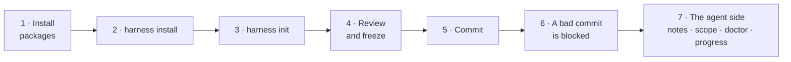

# Walkthrough: install the harness in an app and use it

A full tour on `examples/vite-react` (Vite + React, plain JS/JSX), from an empty repo to a blocked commit. Every output below is real, from [`scripts/verify/e2e-install.sh`](../scripts/verify/e2e-install.sh), which replays this tour automatically. About 10 minutes by hand.



## 1. Get the packages into the repo

```bash
cp -R examples/vite-react /tmp/shop && cd /tmp/shop && rm -rf .harness
git init -b main && printf 'node_modules/\n' > .gitignore && git add -A && git commit -m "app"

mkdir -p vendor/harness && cp /path/to/harness/.tarballs/*.tgz vendor/harness/
npm install -D ./vendor/harness/*.tgz husky@9
npx husky init && : > .husky/pre-commit     # this repo already uses Husky; start with an empty hook
```

## 2. Wire it

```console
$ npx --no-install harness install
harness install:
  - .harness/ sources: 16 file(s) added
  - .gitignore: added .harness/backlog/, .harness/progress/, .harness/init-report.md
  - package.json: added script "harness:check": "harness check"
  - pre-commit hook: appended to .husky/pre-commit (Husky)
  - CI workflow: wrote .github/workflows/harness.yml (npm)
  - harness sync: 7 change(s)

Next:
  - No .harness/architecture.yml yet: run `npx --no-install harness init` to draft the architecture plan and the baseline.
  - In GitHub, protect the main branch: require a PR with an approval and the "harness" check to pass. That is the real guarantee.
```

## 3. Draft the architecture

```console
$ npx --no-install harness init
Wrote .harness/architecture.yml (draft), .harness/baseline.json (3 existing violations frozen) and .harness/init-report.md.
Layers: app > features > components > shared · Domains: cart, catalog
Next: review .harness/init-report.md, adjust .harness/architecture.yml, run `harness check --update-baseline`, then `harness check`.
```

From `.harness/init-report.md`:

```markdown
## Summary
- Adapter: `@harness/adapter-js`, preset `vite-react` (detected)
- Scanned: 14 files, 16 internal imports
- Existing violations frozen in `baseline.json`: **3** (layer-direction: 1, domain-boundary: 1, no-cycles: 1)

## Layers (top to bottom)
| Layer | Paths | Files |
| --- | --- | --- |
| app | `src/main.{js,jsx,ts,tsx}`, `src/App.{js,jsx,ts,tsx}`, `src/pages/**` | 3 |
| features | `src/features/**` | 6 |
| components | `src/components/**` | 2 |
| shared | `src/lib/**` | 2 |

Evidence (imports going down / going up; "up" ones are layer violations):
- app → features: 3 down, 0 up
- features → components: 2 down, 1 up — **mixed: check this order**
```

That "mixed" pair is the example's intentional violation (`Button.jsx` imports from `features/cart`). Here the order is right and the import is wrong, so it stays in the baseline as debt.

## 4. Review and freeze

Adjust `.harness/architecture.yml` if needed (layers, domains, `allow:` with reasons), then:

```console
$ npx --no-install harness check --update-baseline
.harness/baseline.json updated: 3 violation(s) (+0 frozen, -0 fixed).

$ npx --no-install harness check
harness check: no new violations · 3 in baseline · 0 fixed
Result: pass
```

## 5. Commit

```bash
git add -A && git commit -m "adopt harness"     # the hook runs `harness check` on the staged files: green
```

## 6. A bad commit is blocked

A shared helper that imports from a feature (shared is the lowest layer):

```bash
printf "import { CartSummary } from '@/features/cart';\nexport const m = CartSummary;\n" > src/lib/money.js
git add src/lib/money.js && git commit -m "money helper"
```

```console
✖ error layer-direction  src/lib/money.js → src/features/cart/index.js
    Why: src/lib/money.js (shared) imports src/features/cart/index.js (features), but features is above shared.
    Fix: Move what src/lib/money.js needs from features down to shared or a lower layer, or invert the dependency (pass it in as props or callbacks).

harness check: 1 new (1 error, 0 warnings) · 0 in baseline (touched files only)
Result: FAIL (new errors)
husky - pre-commit script failed (code 1)
```

The message is written for the agent too: it says the rule, the reason and the fix. If someone commits without hooks, the CI job (`.github/workflows/harness.yml`) fails the PR with the same message.

## 7. The agent side

**A module note** that reaches Claude Code before it edits (through the hook `harness sync` installed) and any agent through the index in `AGENTS.md`:

```console
$ printf -- '---\npaths: ["src/features/cart/**"]\n---\n- 2026-11-04: totals are integer cents.\n' > .harness/notes/cart.md
$ npx --no-install harness sync
harness sync: 1 change(s):
  - updated the notes index in AGENTS.md

$ npx --no-install harness notes src/features/cart/cartStore.js
Note .harness/notes/cart.md (applies to src/features/cart/**) for src/features/cart/cartStore.js:
- 2026-11-04: totals are integer cents.
```

**Sizing a task** before starting:

```console
$ npx --no-install harness scope src/features/cart
Files: 3
Domains: cart
Public API touched: src/features/cart/index.js
architecture.yml touched: no
Notes to read: .harness/notes/cart.md
Minimum level: large (touches a public API (src/features/cart/index.js))
```

**Triage vs. reality** (`harness doctor`, local only): the agent declared `small` in `.harness/progress/triage.log` but touched four code files.

```console
$ npx --no-install harness doctor
! warn  triage-mismatch  .harness/progress/triage.log
    Why: Declared small (line 1: "add a discount constant"), but the diff looks medium: 4 files (small allows 3).
    Fix: If the task grew, say so and append a new line with level medium. If the thresholds are wrong for this repo, tune .harness/doctor.yml.

harness doctor: 0 errors, 1 warning
```

**The notebook** for a medium task, edited one line at a time:

```console
$ npx --no-install harness progress new
Created .harness/progress/feat-discounts.md (mini). Fill in the goal and the done criteria before editing code.
$ npx --no-install harness progress show
.harness/progress/feat-discounts.md · open · updated 2026-11-04
done criteria:
   1. [ ] ...
   2. [ ] `harness check` without new violations
subtasks:
   3. [~] ...
   4. [ ] ...
Next step: ...
```

## Undo

Delete the folder. In a real repo: `git switch -` and delete the branch.
