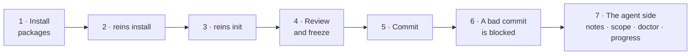

# Walkthrough: install reins in an app and use it

A full tour on `examples/vite-react` (Vite + React, plain JS/JSX), from an empty repo to a blocked commit. Every output below is real, from [`scripts/verify/e2e-install.sh`](../scripts/verify/e2e-install.sh), which replays this tour automatically (`notes new` and `resume`: [`scripts/verify/cc-resume.sh`](../scripts/verify/cc-resume.sh); the notebook text is shortened). About 10 minutes by hand.



## 1. Get the packages into the repo

```bash
cp -R examples/vite-react /tmp/shop && cd /tmp/shop && rm -rf .reins
git init -b main && printf 'node_modules/\n' > .gitignore && git add -A && git commit -m "app"

npm install -D @agentreins/cli @agentreins/adapter-js husky@9
npx husky init && : > .husky/pre-commit     # this repo already uses Husky; start with an empty hook
```

(The automated replay, `e2e-install.sh`, installs the same packages from local tarballs, so it tests the code before it is published.)

## 2. Wire it

```console
$ npx reins install
reins install:
  - .reins/ sources: 19 file(s) added
  - .gitignore: added .reins/backlog/, .reins/progress/, .reins/init-report.md
  - package.json: added script "reins:check": "reins check"
  - pre-commit hook: appended to .husky/pre-commit (Husky)
  - CI workflow: wrote .github/workflows/reins.yml (npm)
  - reins sync: 7 change(s)

Next:
  - No .reins/architecture.yml yet: run `npx reins init` to draft the architecture plan and the baseline.
  - In GitHub, protect the main branch: require a PR with an approval and the "reins" check to pass. That is the real guarantee.
```

## 3. Draft the architecture

```console
$ npx reins init
Wrote .reins/architecture.yml (draft), .reins/baseline.json (3 existing violations frozen) and .reins/init-report.md.
Layers: app > features > components > shared · Domains: cart, catalog
Module notes drafted from the code: .reins/notes/cart.md, .reins/notes/catalog.md. Ask your agent to fill in their TODO lines (in Claude Code: /reins-notes).
Next: review .reins/init-report.md and adjust .reins/architecture.yml (in Claude Code: /reins-arch), run `reins check --update-baseline`, then `reins check`.
```

From `.reins/init-report.md`:

```markdown
## Summary
- Adapter: `@agentreins/adapter-js`, preset `vite-react` (detected)
- Scanned: 14 files, 16 internal imports
- Existing violations frozen in `baseline.json`: **3** (layer-direction: 1, domain-boundary: 1, no-cycles: 1)

## Layers (top to bottom)
| Layer | Paths | Files |
| --- | --- | --- |
| app | `src/main.{js,jsx,ts,tsx}`, `src/App.{js,jsx,ts,tsx}`, `src/pages/**` | 3 |
| features | `src/features/**` | 6 |
| components | `src/components/**` | 2 |
| shared | `src/lib/**` | 2 |

Evidence (imports going down / going up; "up" ones are layer violations):
- app → features: 3 down, 0 up
- features → components: 2 down, 1 up — **mixed: check this order**
```

That "mixed" pair is the example's intentional violation (`Button.jsx` imports from `features/cart`). Here the order is right and the import is wrong, so it stays in the baseline as debt.

## 4. Review and freeze

Adjust `.reins/architecture.yml` if needed (layers, domains, `allow:` with reasons), then:

```console
$ npx reins check --update-baseline
.reins/baseline.json updated: 3 violation(s) (+0 frozen, -0 fixed).

$ npx reins check
reins check: no new violations · 3 in baseline · 0 fixed
Result: pass
```

## 5. Commit

```bash
git add -A && git commit -m "adopt reins"     # the hook runs `reins check` on the staged files: green
```

## 6. A bad commit is blocked

A shared helper that imports from a feature (shared is the lowest layer):

```bash
printf "import { CartSummary } from '@/features/cart';\nexport const m = CartSummary;\n" > src/lib/money.js
git add src/lib/money.js && git commit -m "money helper"
```

```console
✖ error layer-direction  src/lib/money.js → src/features/cart/index.js
    Why: src/lib/money.js (shared) imports src/features/cart/index.js (features), but features is above shared.
    Fix: Move what src/lib/money.js needs from features down to shared or a lower layer, or invert the dependency (pass it in as props or callbacks).

reins check: 1 new (1 error, 0 warnings) · 0 in baseline (touched files only)
Result: FAIL (new errors)
husky - pre-commit script failed (code 1)
```

The message is written for the agent too: it says the rule, the reason and the fix. If someone commits without hooks, the CI job (`.github/workflows/reins.yml`) fails the PR with the same message.

## 7. The agent side

**A module note** that reaches Claude Code before it edits (through the hook `reins sync` installed) and any agent through the index in `AGENTS.md`:

```console
$ printf -- '---\npaths: ["src/features/cart/**"]\n---\n- 2026-11-04: totals are integer cents.\n' > .reins/notes/cart.md
$ npx reins sync
reins sync: 1 change(s):
  - updated the notes index in AGENTS.md

$ npx reins notes src/features/cart/cartStore.js
Note .reins/notes/cart.md (applies to src/features/cart/**) for src/features/cart/cartStore.js:
- 2026-11-04: totals are integer cents.
```

**Module notes.** `init` already drafted one per domain (step 3). For any other folder, `notes new` drafts one; the import graph fills in the map, and the agent (or you) replaces the `TODO` lines with what the code can't say. Ask your agent: *"fill in the TODO lines of the notes in .reins/notes/"*.

```console
$ npx reins notes new src/lib --name shared
Drafted .reins/notes/shared.md. Fill in the TODO lines (purpose, how it works, decisions with why, traps), then run `reins sync` to add it to the AGENTS.md index.
```

What `init` drafted for `cart`:

```markdown
## Map
- Public API: `src/features/cart/index.js`
- Files: 3. Most imported: `src/features/cart/cartStore.js`, `src/features/cart/index.js`, `src/features/cart/CartSummary.jsx`
- Used by: src/components (1), src/pages (1)
- Depends on: src/components (1)
```

**Resuming a task** in a new session, or after the conversation was compacted. Claude Code receives this on its own through the `SessionStart` hook; any other agent runs the command:

```console
$ npx reins resume
Context to resume the work on branch feat/coupons (from reins resume). Read it before continuing.

## Progress notebook .reins/progress/feat-coupons.md
Resume from its "Next step"; keep it updated with `npx reins progress`.

# feat/coupons · status: open · updated: 2026-11-04
**Goal:** coupons in the cart.
**Next step:** wire the coupon field in CartSummary.

## Files changed on this branch (1)
- src/features/cart/cartStore.js

## Module notes for those files (follow them)
### .reins/notes/cart.md (applies to src/features/cart/**)
...
```

**Sizing a task** before starting:

```console
$ npx reins scope src/features/cart
Files: 3
Domains: cart
Public API touched: src/features/cart/index.js
architecture.yml touched: no
Notes to read: .reins/notes/cart.md
Minimum level: large (touches a public API (src/features/cart/index.js))
```

**Triage vs. reality** (`reins doctor`, local only): the agent declared `small` in `.reins/progress/triage.log` but touched four code files.

```console
$ npx reins doctor
! warn  triage-mismatch  .reins/progress/triage.log
    Why: Declared small (line 1: "add a discount constant"), but the diff looks medium: 4 files (small allows 3).
    Fix: If the task grew, say so and append a new line with level medium. If the thresholds are wrong for this repo, tune .reins/doctor.yml.

reins doctor: 0 errors, 1 warning
```

**The notebook** for a medium task, edited one line at a time:

```console
$ npx reins progress new
Created .reins/progress/feat-discounts.md (mini). Fill in the goal and the done criteria before editing code.
$ npx reins progress show
.reins/progress/feat-discounts.md · open · updated 2026-11-04
done criteria:
   1. [ ] ...
   2. [ ] `reins check` without new violations
subtasks:
   3. [~] ...
   4. [ ] ...
Next step: ...
```

## Undo

Delete the folder. In a real repo: `git switch -` and delete the branch.
